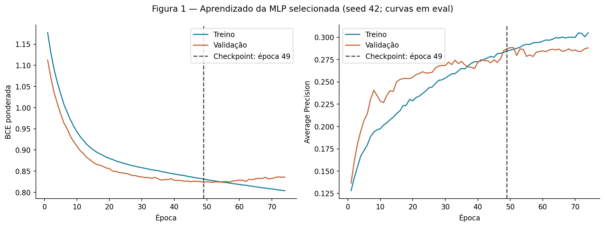
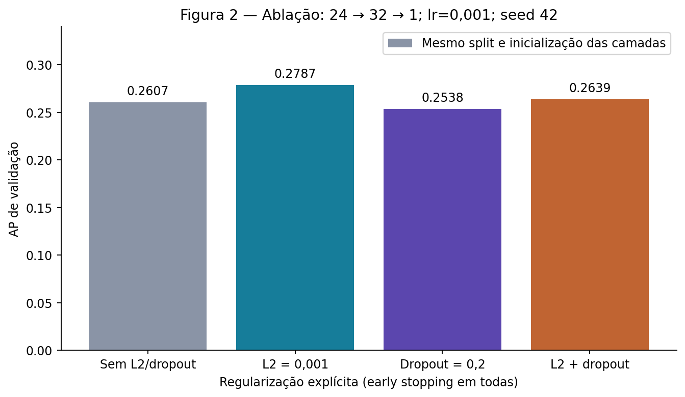
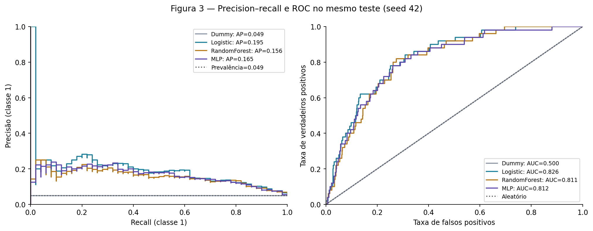
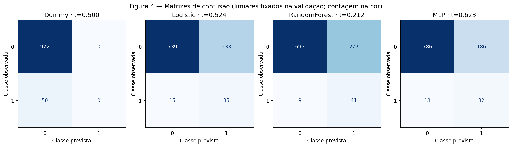
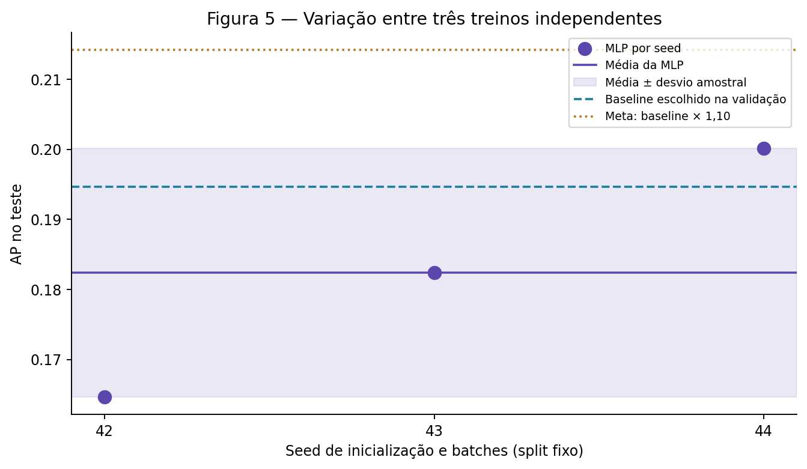
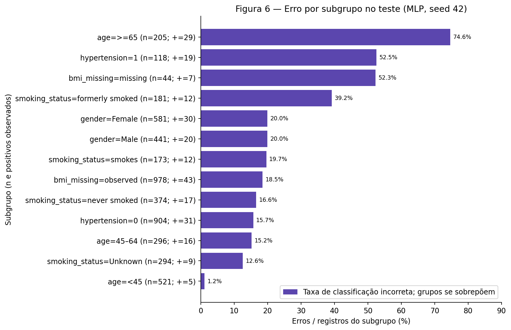
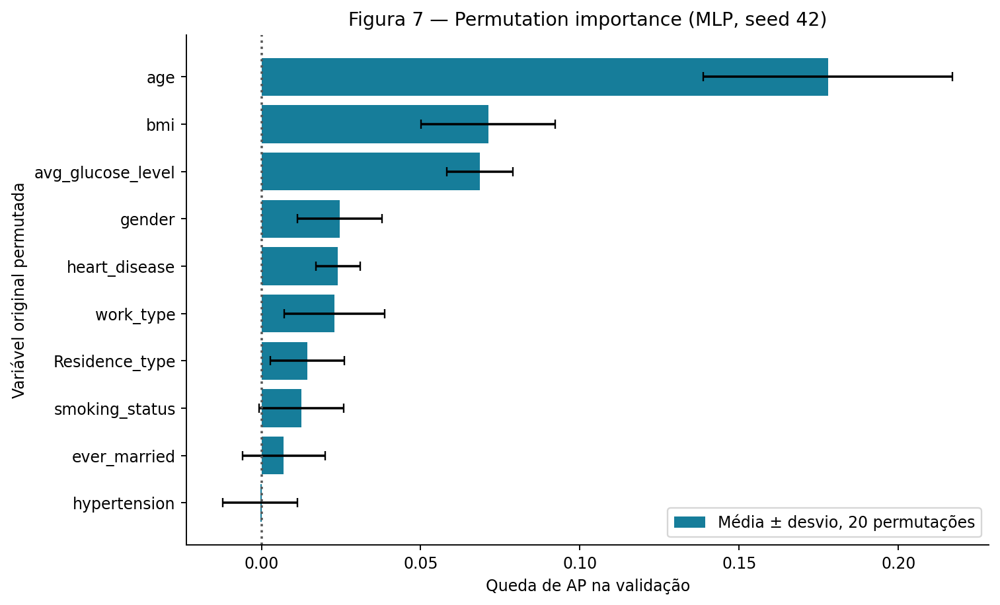

# Projeto 2 — Classificação de registros de AVC com uma MLP

**Resultado:** a MLP obteve AP **0.1824 ± 0.0177** no teste,
contra **0.1947** da regressão logística. A rede não atingiu o critério fixado
antes do treino. O ranking melhor na validação não se sustentou no teste.

A pergunta é se uma rede aprende relações que um modelo simples não captura. Mantemos
a tarefa da [EDA](../eda/index.md): identificar `stroke=1` no **Stroke Prediction v1**;
`0` significa ausência de AVC **registrado**. Sem datas, não demonstramos previsão de AVC futuro.

[Como reproduzir](reproduce.md) · [Guia para entender e explicar](study_guide.md) ·
[Protocolo definido antes do treinamento](protocol.json).

Referências do curso: [enunciado](https://insper.github.io/ann-dl/2026.2/projects/supervised/),
[conceitos](https://insper.github.io/ann-dl/2026.2/classes/concepts/),
[divisão dos dados](https://insper.github.io/ann-dl/2026.2/classes/data/splitting/),
[vazamento](https://insper.github.io/ann-dl/2026.2/classes/data/leakage/),
[desbalanceamento](https://insper.github.io/ann-dl/2026.2/classes/data/imbalance/),
[MLP](https://insper.github.io/ann-dl/2026.2/classes/mlp/),
[otimização](https://insper.github.io/ann-dl/2026.2/classes/optimization/),
[regularização](https://insper.github.io/ann-dl/2026.2/classes/regularization/),
[métricas](https://insper.github.io/ann-dl/2026.2/classes/metrics/classification/).

## 0. Starting point

### Continuidade da EDA e prevenção de vazamento

A base tem 5.110 registros e 10 atributos úteis. Importamos `make_preprocessor()` de
`docs/projects/eda/code/preprocessing.py`, em vez de copiar a implementação. O pipeline conserva:
mediana para numéricos ausentes, `log1p` para glicose/IMC, padronização das medidas,
indicador binário de IMC ausente e one-hot nas sete categorias. `Unknown` em tabagismo
permanece categoria. `id` e `stroke` não entram na matriz de atributos.

A divisão externa é a mesma da EDA: primeira dobra de
`StratifiedGroupKFold(5, shuffle=True, random_state=42)`, com grupos formados pelo hash
dos atributos. Conferimos todos os índices contra a [lista da EDA](../eda/tables/split.csv).
Os 4.088 registros de desenvolvimento são subdivididos pela mesma regra em
**3270 de treino e 818 de validação**;
o **teste conserva 1022 registros**. Nenhum perfil aparece em duas partições.
Há **159 / 40 / 50 positivos**,
respectivamente. [Índices das três partições](tables/split.csv).

Imputador, scaler e vocabulário one-hot são **reajustados somente nas 3270 linhas de treino**;
validação e teste recebem `transform`. A matriz tem **24 entradas**.
A mediana de IMC nesse treino é **28.1**. Não usamos PCA/t-SNE/UMAP
como entradas: na EDA eram ferramentas exploratórias. Não recebemos uma devolutiva de correção
da EDA; não alegamos ter corrigido comentários inexistentes. A adaptação necessária é retirar
a validação antes de ajustar o pipeline.

### Métrica e meta estabelecidas antes do treino

A métrica principal é **Average Precision (AP)**, a integral por degraus da curva
precision–recall, calculada por `average_precision_score`; aqui esse é o significado de PR-AUC.
Com poucos positivos, acurácia alta pode ocorrer sem detectar um único AVC registrado.
AP avalia o ranking e não depende de um limiar. ROC-AUC e métricas de classe são complementares.

**Meta pré-fixada:** AP média da MLP nas três seeds no teste ≥ **1,10 × AP do baseline
escolhido pela maior AP de validação**. O ganho de 10% é um objetivo educacional de desempenho,
não um limiar de utilidade clínica. [Registro anterior ao treino](tables/protocol_before_training.json)
e [seleção congelada](tables/selection.json) registram o protocolo e hash do código.

O teste da EDA já havia passado por checagens de qualidade e transformação; não era desconhecido
em sentido absoluto. **Nenhuma métrica de classificador no teste foi usada nesta busca**.
A avaliação final ocorreu em lote depois de todos os treinos, limiares e configurações fixados.

## 1. Baselines

Os três modelos usam exatamente a mesma matriz do pipeline ajustado no treino.
`DummyClassifier(strategy="most_frequent")` sempre prevê a classe 0, com limiar 0,5.
A regressão logística usa `C=1`, `class_weight="balanced"` e até 3.000 iterações;
é a referência linear regularizada, sem busca de C. A floresta opcional tem 300 árvores,
`min_samples_leaf=5`, `balanced_subsample`, seed 42: captura não linearidades sem rede.
Seus parâmetros foram fixados antes da avaliação.

**Tabela 1 — Baselines na validação, ordenados por AP.**

| model        |     ap |   roc_auc |   macro_f1 |   precision_1 |   recall_1 |   f2_1 |   threshold |
|:-------------|-------:|----------:|-----------:|--------------:|-----------:|-------:|------------:|
| Logistic     | 0.2359 |    0.8736 |     0.5770 |        0.1683 |     0.8750 | 0.4755 |      0.5241 |
| RandomForest | 0.2196 |    0.8610 |     0.5484 |        0.1464 |     0.8750 | 0.4386 |      0.2123 |
| Dummy        | 0.0489 |    0.5000 |     0.4875 |        0.0000 |     0.0000 | 0.0000 |      0.5000 |

O baseline escolhido foi **Logistic**, AP **0.2359**.
Dummy tem acurácia **95.11%**
e recall positivo zero. Portanto, acurácia não guia a escolha.

Os limiares dos modelos não triviais maximizam **F2 apenas na validação**. Como
F2 = 5TP/(5TP + 4FN + FP), a regra valoriza reduzir FN, aceitando mais FP;
isso explicita uma preferência educacional por recall. Não estimamos custos clínicos reais.
Empates usam o maior limiar. Scores com ponderação de classe **não são probabilidades calibradas**.

## 2. The network

A busca comparou camadas ocultas de 16, 32, 32–16 e 64–32 unidades. A escolhida foi
**c05: 24 → 16 → 1**, com ReLU nas ocultas e **uma saída linear (logit)**.
São **417 parâmetros**, contra **3270 linhas de treino**,
razão **0.128 parâmetro/linha**, mas só
159 positivos. Essa razão não garante generalização.
Uma MLP pequena é proporcional ao porte e permite interações sem supor que tabelas
exijam redes profundas. A seleção favoreceu a menor largura testada, pela AP de validação.

As camadas ocultas usam inicialização **Kaiming normal**, apropriada à ReLU, e biases zero;
a saída usa **Xavier normal**. A loss é `BCEWithLogitsLoss`, que combina sigmoid e
entropia cruzada binária de modo numericamente estável. O `forward` **não** aplica sigmoid;
ela é aplicada uma única vez para produzir scores na inferência.

O desbalanceamento é tratado por **pos_weight = negativos/positivos = 19.5660**,
calculado somente no treino e mantido na validação. Não há reamostragem de validação/teste.
Esse peso aumenta a contribuição dos raros positivos no gradiente; não cria informação nova.

**Arquitetura executável:**

```python
--8<-- "docs/projects/classification/code/network.py"
```

## 3. Training

Usamos **Adam**, `lr=0.001`, betas padrão (0,9; 0,999), batches de **128**,
até **200 épocas**. Adam adapta a escala das atualizações; 0,001 é o ponto de partida
para MLP tabular apresentado na aula. A busca testa também 0,0003 e 0,003.
O batch equilibra atualizações frequentes e custo nesta base pequena; não foi ajustado pelo teste.
O treinamento roda em CPU, uma thread, com seeds de Python, NumPy e PyTorch fixadas.

Em cada batch: zerar gradientes, forward, calcular BCE, `backward()` e `optimizer.step()`.
Depois de cada época, `eval()` desativa dropout; treino e validação são medidos com a mesma BCE
ponderada, sem incluir a penalidade L2 na curva. `no_grad()` evita construir o grafo na avaliação.

O **early stopping** monitora BCE de validação, paciência **25 épocas** e melhora mínima
**0,0001**. O checkpoint de menor BCE aceito por esse critério é restaurado antes de calcular
AP e escolher o limiar. A AP seleciona a configuração; a BCE seleciona a época.
Esses objetivos não são iguais, e por isso as duas curvas são mostradas.



Na seed 42, o melhor checkpoint é a **época 49**:
BCE treino **0.8315**, validação **0.8235**,
AP treino **0.2847**, AP validação **0.2872**.
A execução para na época **74**; na última época a BCE de treino é
**0.8037** e a de validação **0.8358**.
O período após a melhor época indica que continuar reduzindo o erro de treino não compra melhora
de validação sustentada; é o sinal operacional de sobreajuste usado para parar.
A convergência é operacional, não prova de ótimo global.

**Loop executado:**

```python
--8<-- "docs/projects/classification/code/training.py"
```

## 4. Regularization and hyperparameters

Testamos **12 configurações** previamente listadas em `protocol.json`, todas com seed 42.
As quatro primeiras isolam duas técnicas na mesma arquitetura 24–32–1 e lr 0,001:
**L2 via `Adam(weight_decay=0.001)`**, **dropout 0,2**, ambos e nenhuma regularização explícita.
L2 penaliza pesos grandes; dropout remove ativações aleatoriamente apenas no treino.
Aqui é Adam com L2 acoplado, não AdamW. **Early stopping é comum a todas**;
“sem regularização” nesta ablação significa sem L2 e sem dropout, não sem parada antecipada.

**Tabela 2 — Ablação controlada na validação.**

| id   |   dropout |   weight_decay |     ap |   best_epoch |   stopped_epoch |
|:-----|----------:|---------------:|-------:|-------------:|----------------:|
| c01  |    0.0000 |         0.0000 | 0.2607 |           36 |              61 |
| c02  |    0.0000 |         0.0010 | 0.2787 |           50 |              75 |
| c03  |    0.2000 |         0.0000 | 0.2538 |           62 |              87 |
| c04  |    0.2000 |         0.0010 | 0.2639 |           62 |              87 |



A AP sem L2/dropout foi **0.2607**; com L2, **0.2787**;
com dropout, **0.2538**; com ambos, **0.2639**.
Regularização não oferece melhora automática: muda o equilíbrio entre ajuste e generalização.
Essa ablação usa uma seed, portanto não isola a variância entre inicializações.

**Tabela 3 — Busca completa ordenada por AP de validação (maior é melhor).**

|   rank | id   | hidden   |     lr |   dropout |   weight_decay |   parameters |     ap |   best_epoch |   stopped_epoch |
|-------:|:-----|:---------|-------:|----------:|---------------:|-------------:|-------:|-------------:|----------------:|
|      1 | c05  | 16       | 0.0010 |    0.0000 |         0.0000 |          417 | 0.2872 |           49 |              74 |
|      2 | c09  | 32       | 0.0030 |    0.0000 |         0.0010 |          833 | 0.2857 |           21 |              46 |
|      3 | c07  | 64-32    | 0.0010 |    0.2000 |         0.0010 |         3713 | 0.2831 |           50 |              75 |
|      4 | c10  | 64-32    | 0.0003 |    0.2000 |         0.0010 |         3713 | 0.2826 |          107 |             132 |
|      5 | c02  | 32       | 0.0010 |    0.0000 |         0.0010 |          833 | 0.2787 |           50 |              75 |
|      6 | c04  | 32       | 0.0010 |    0.2000 |         0.0010 |          833 | 0.2639 |           62 |              87 |
|      7 | c08  | 32       | 0.0003 |    0.0000 |         0.0010 |          833 | 0.2631 |          147 |             172 |
|      8 | c01  | 32       | 0.0010 |    0.0000 |         0.0000 |          833 | 0.2607 |           36 |              61 |
|      9 | c03  | 32       | 0.0010 |    0.2000 |         0.0000 |          833 | 0.2538 |           62 |              87 |
|     10 | c12  | 32-16    | 0.0010 |    0.4000 |         0.0100 |         1345 | 0.2532 |           49 |              74 |
|     11 | c06  | 64-32    | 0.0010 |    0.0000 |         0.0000 |         3713 | 0.2514 |           13 |              38 |
|     12 | c11  | 64-32    | 0.0030 |    0.2000 |         0.0010 |         3713 | 0.2451 |           22 |              47 |

Escolhemos **c05**, AP **0.2872**, antes de abrir o teste.
Não adicionamos uma configuração depois de observar o resultado final.
[Busca completa](tables/search.csv) · [Histórico por época](tables/history_search.csv).

## 5. Test evaluation

A arquitetura escolhida foi **retreinada do zero nas seeds 42, 43 e 44**.
As três usam o mesmo treino/validação; cada uma restaura seu checkpoint e escolhe seu limiar
na validação. Mantemos a validação separada para early stopping e limiar, portanto
**não** juntamos as 4.088 linhas para o ajuste final. Os baselines também são reajustados
no mesmo treino. Nenhuma seed foi escolhida pelo teste e não fazemos ensemble.
A seed 42 é a referência das figuras e análise de erros, fixada no protocolo.

[Registro dos treinos e limiares antes do teste](tables/final_before_test.json) ·
[Avaliação e versões](tables/evaluation.json) · [Predições auditáveis](tables/test_predictions.csv).

**Tabela 4 — Todos os modelos no mesmo teste. AP/ROC não dependem do limiar.**

| model        |   seed |     ap |   roc_auc |   macro_f1 |   precision_1 |   recall_1 |   f1_1 |   threshold |
|:-------------|-------:|-------:|----------:|-----------:|--------------:|-----------:|-------:|------------:|
| Dummy        |     42 | 0.0489 |    0.5000 |     0.4875 |        0.0000 |     0.0000 | 0.0000 |      0.5000 |
| Logistic     |     42 | 0.1947 |    0.8258 |     0.5382 |        0.1306 |     0.7000 | 0.2201 |      0.5241 |
| RandomForest |     42 | 0.1564 |    0.8114 |     0.5261 |        0.1289 |     0.8200 | 0.2228 |      0.2123 |
| MLP          |     42 | 0.1647 |    0.8124 |     0.5620 |        0.1468 |     0.6400 | 0.2388 |      0.6228 |
| MLP          |     43 | 0.1824 |    0.8125 |     0.5451 |        0.1357 |     0.7000 | 0.2273 |      0.5107 |
| MLP          |     44 | 0.2001 |    0.8327 |     0.5266 |        0.1270 |     0.7800 | 0.2185 |      0.4550 |

**Tabela 5 — Precisão, recall e F1 por classe (seed 42).**

| model        |   class |   precision |   recall |   f1-score |   support |
|:-------------|--------:|------------:|---------:|-----------:|----------:|
| Dummy        |       0 |      0.9511 |   1.0000 |     0.9749 |  972.0000 |
| Dummy        |       1 |      0.0000 |   0.0000 |     0.0000 |   50.0000 |
| Logistic     |       0 |      0.9801 |   0.7603 |     0.8563 |  972.0000 |
| Logistic     |       1 |      0.1306 |   0.7000 |     0.2201 |   50.0000 |
| RandomForest |       0 |      0.9872 |   0.7150 |     0.8294 |  972.0000 |
| RandomForest |       1 |      0.1289 |   0.8200 |     0.2228 |   50.0000 |
| MLP          |       0 |      0.9776 |   0.8086 |     0.8851 |  972.0000 |
| MLP          |       1 |      0.1468 |   0.6400 |     0.2388 |   50.0000 |

As demais seeds também têm métricas por classe no [CSV completo](tables/test_per_class.csv).
O teste tem **50 positivos/1022 registros**, prevalência
**4.89%**. A AP de Dummy é essa prevalência, enquanto
ROC-AUC de Dummy é 0,5. A rede aprende sinal acima da referência trivial, mas isso não
demonstra vantagem sobre o modelo linear.



Na seed 42, AP **0.1647** e ROC-AUC **0.8124** resumem rankings diferentes;
a PR expõe melhor a baixa precisão entre os alarmes nesta base rara.



No limiar **0.622840**, a rede de referência tem **32 TP,
186 FP, 18 FN e 786 TN**.
Precisão positiva **14.68%**, recall **64.00%**,
F1 positivo **0.2388** e macro F1 **0.5620**.
A logística tem **35 TP e 233 FP** com seu próprio
limiar de validação; não comparamos usando limiar ajustado no teste.



A AP da MLP é **0.182385 ± 0.017730**
(média ± desvio **amostral**, `ddof=1`, três seeds). A diferença média para o baseline é
**-0.012297**, magnitude **menor** que o desvio entre seeds.
Isso não é um teste de significância: mede só variação de inicialização e batches,
não incerteza amostral, deslocamento de domínio ou variância da divisão dos dados.
Com apenas 50 positivos no teste, um único FN altera o recall em 2 pontos percentuais.

O ganho relativo é **-6.32%**. A meta exigiria AP ≥
**0.214151**; **não foi atingida**.
Comparar 12 candidatas em uma validação com somente 40 positivos também pode selecionar
uma configuração favorecida pelo ruído. A queda no teste é compatível com esse problema;
não prova, por si só, uma causa única.

## 6. Error analysis

### Subgrupos definidos antes do teste

A taxa de erro é **(FP+FN)/n do subgrupo** na MLP seed 42. Ela é diferente de
taxa de falsos negativos: um grupo quase todo negativo pode ter erro baixo e recall zero.
Os grupos se sobrepõem; não se somam. Mostramos n e número de positivos para não ocultar suporte.

**Tabela 6 — Erros e recall por subgrupo.**

| feature        | group           |   n |   positive |   error_rate |   fp |   fn |   recall_1 |
|:---------------|:----------------|----:|-----------:|-------------:|-----:|-----:|-----------:|
| age            | >=65            | 205 |         29 |       0.7463 |  152 |    1 |     0.9655 |
| hypertension   | 1               | 118 |         19 |       0.5254 |   56 |    6 |     0.6842 |
| bmi_missing    | missing         |  44 |          7 |       0.5227 |   22 |    1 |     0.8571 |
| smoking_status | formerly smoked | 181 |         12 |       0.3923 |   68 |    3 |     0.7500 |
| gender         | Female          | 581 |         30 |       0.1997 |  104 |   12 |     0.6000 |
| gender         | Male            | 441 |         20 |       0.1995 |   82 |    6 |     0.7000 |
| smoking_status | smokes          | 173 |         12 |       0.1965 |   30 |    4 |     0.6667 |
| bmi_missing    | observed        | 978 |         43 |       0.1851 |  164 |   17 |     0.6047 |
| smoking_status | never smoked    | 374 |         17 |       0.1658 |   55 |    7 |     0.5882 |
| hypertension   | 0               | 904 |         31 |       0.1571 |  130 |   12 |     0.6129 |
| age            | 45–64           | 296 |         16 |       0.1520 |   33 |   12 |     0.2500 |
| smoking_status | Unknown         | 294 |          9 |       0.1259 |   33 |    4 |     0.5556 |
| age            | <45             | 521 |          5 |       0.0115 |    1 |    5 |     0.0000 |



- **age=>=65:** 152 FP + 1 FN em 205 registros = 74.63% de erro; 29 positivos. Hipótese: Idade domina o ranking: pode elevar alarmes nos mais velhos e ocultar AVC em jovens; associação observacional não é causalidade.
- **hypertension=1:** 56 FP + 6 FN em 118 registros = 52.54% de erro; 19 positivos. Hipótese: A prevalência e a composição etária podem diferir; é preciso estudar interações e não atribuir o erro apenas à hipertensão.
- **bmi_missing=missing:** 22 FP + 1 FN em 44 registros = 52.27% de erro; 7 positivos. Hipótese: A ausência pode atuar como marcador de coleta; associação com o alvo pode não se repetir em outra instituição.
- **smoking_status=formerly smoked:** 68 FP + 3 FN em 181 registros = 39.23% de erro; 12 positivos. Hipótese: Tabagismo, idade e preenchimento podem estar associados; a hipótese exige mais amostras e avaliação externa.
- **gender=Female:** 104 FP + 12 FN em 581 registros = 19.97% de erro; 30 positivos. Hipótese: Diferenças de composição e poucos positivos podem explicar o contraste; estes números não demonstram equidade.

Entre menores de 45 anos, o recall é **0/5 = 0%**, apesar de erro global baixo nesse grupo.
Entre 45–64 anos, o recall é **4/16 = 25%**; entre ≥65, é **28/29 = 96,55%**,
com **152 falsos positivos**. A forte preferência por idade ajuda a explicar os dois extremos.
Não há `gender=Other` no teste; não estimamos seu desempenho. Nenhuma conclusão robusta
sobre grupos raros ou equidade decorre deste split.

### Piores exemplos

Selecionamos cinco FN e cinco FP pela maior distância ao limiar no lado incorreto.
Isso mede o afastamento da decisão, **não confiança probabilística calibrada**.
`source_row` é o índice original sem cabeçalho; o identificador `id` continua excluído.

**Tabela 7 — Piores erros de cada tipo (MLP seed 42).**

|   source_row |   y |   score |     age |   avg_glucose_level | bmi     |   hypertension |
|-------------:|----:|--------:|--------:|--------------------:|:--------|---------------:|
|          245 |   1 |  0.0134 | 14.0000 |             57.9300 | 30.9    |              0 |
|          210 |   1 |  0.1124 | 39.0000 |             83.2400 | 26.3    |              0 |
|           49 |   1 |  0.1174 | 39.0000 |             58.0900 | 39.2    |              1 |
|          180 |   1 |  0.1701 | 46.0000 |             78.1800 | 30.8    |              0 |
|          118 |   1 |  0.1745 | 38.0000 |             82.2800 | 24.0    |              0 |
|         2192 |   0 |  0.9493 | 77.0000 |            109.5100 | ausente |              1 |
|         2529 |   0 |  0.9401 | 71.0000 |            105.5500 | ausente |              1 |
|         1906 |   0 |  0.9353 | 77.0000 |             74.2600 | ausente |              0 |
|         1875 |   0 |  0.9321 | 80.0000 |             86.6800 | 27.7    |              1 |
|         3951 |   0 |  0.9307 | 79.0000 |             92.4300 | ausente |              1 |

Os cinco FN têm idades de **14–46** anos;
os cinco FP, **71–80** anos, e
**4/5** deles têm IMC ausente. Hipóteses para cada exemplo:

- Linha 245: FN, idade 14, score 0.0134, distância ao limiar 0.6094. Hipótese: perfil jovem pode receber score baixo porque a idade domina o aprendizado.
- Linha 210: FN, idade 39, score 0.1124, distância ao limiar 0.5104. Hipótese: perfil jovem pode receber score baixo porque a idade domina o aprendizado.
- Linha 49: FN, idade 39, score 0.1174, distância ao limiar 0.5055. Hipótese: perfil jovem pode receber score baixo porque a idade domina o aprendizado.
- Linha 180: FN, idade 46, score 0.1701, distância ao limiar 0.4527. Hipótese: perfil jovem pode receber score baixo porque a idade domina o aprendizado.
- Linha 118: FN, idade 38, score 0.1745, distância ao limiar 0.4484. Hipótese: perfil jovem pode receber score baixo porque a idade domina o aprendizado.
- Linha 2192: FP, idade 77, score 0.9493, distância ao limiar 0.3264. Hipótese: idade elevada e/ou IMC ausente podem produzir um alarme mesmo sem AVC registrado.
- Linha 2529: FP, idade 71, score 0.9401, distância ao limiar 0.3172. Hipótese: idade elevada e/ou IMC ausente podem produzir um alarme mesmo sem AVC registrado.
- Linha 1906: FP, idade 77, score 0.9353, distância ao limiar 0.3125. Hipótese: idade elevada e/ou IMC ausente podem produzir um alarme mesmo sem AVC registrado.
- Linha 1875: FP, idade 80, score 0.9321, distância ao limiar 0.3092. Hipótese: idade elevada e/ou IMC ausente podem produzir um alarme mesmo sem AVC registrado.
- Linha 3951: FP, idade 79, score 0.9307, distância ao limiar 0.3079. Hipótese: idade elevada e/ou IMC ausente podem produzir um alarme mesmo sem AVC registrado.

Essas hipóteses descrevem falhas do modelo; não explicam a ocorrência individual de AVC.
Podem existir atributos ausentes ou problemas de cronologia que esta base não permite investigar.

### Permutation importance e diálogo com a EDA

Na **validação**, permutamos cada variável original **20 vezes**, recalculando a AP
sem reajustar o modelo nem o pipeline. Para `bmi`, valor e ausência são permutados juntos
antes da transformação; para categorias, todas as colunas one-hot mudam de forma coerente.
Usar validação aqui preserva o teste para avaliação, sem novas decisões a partir de suas métricas.

**Tabela 8 — Importância por queda de AP na validação.**

| feature           |    mean |    std |
|:------------------|--------:|-------:|
| age               |  0.1778 | 0.0391 |
| bmi               |  0.0712 | 0.0211 |
| avg_glucose_level |  0.0686 | 0.0104 |
| gender            |  0.0246 | 0.0133 |
| heart_disease     |  0.0241 | 0.0070 |
| work_type         |  0.0229 | 0.0158 |
| Residence_type    |  0.0144 | 0.0116 |
| smoking_status    |  0.0125 | 0.0133 |
| ever_married      |  0.0070 | 0.0129 |
| hypertension      | -0.0004 | 0.0117 |



A maior queda vem de **age: 0.1778 ± 0.0391**.
Idade dominante e a contribuição de glicose/IMC são compatíveis com a EDA, que mostrou
associações e sobreposição de classes. O efeito quase nulo de hipertensão, apesar da
associação bruta, lembra que atributos correlacionados podem carregar informação redundante.
Importância negativa ou próxima de zero pode ser ruído ou substituição por outro atributo;
não equivale a ausência de associação, efeito causal ou irrelevância clínica.
Os desvios são de permutações no mesmo conjunto, não intervalos de confiança populacional.

## 7. Conclusion

**A rede não compensou como melhoria de AP sobre a regressão logística neste experimento.**
Ela superou Dummy e ganhou na validação, mas sua média no teste ficou abaixo do baseline linear,
sem atingir a meta de 10%. O resultado sustenta manter a logística como referência mais simples
para novos estudos, sem declarar que redes nunca funcionem nesta base.

Limitações: poucos positivos; uma única divisão de validação; busca com 12 candidatas;
origem confidencial; ausência de datas e de população amostral definida; pesos de classe sem
calibração; dependência do padrão de ausência de IMC e da idade; sem validação externa.
A EDA já havia observado algumas propriedades do teste, embora não métricas preditivas.

Um falso negativo deixaria um registro positivo sem identificação; um falso positivo poderia
gerar alarme e trabalho adicional se alguém tentasse usar a saída para triagem. Os erros
não têm impacto real neste estudo educacional. Não há validação que sustente aplicação clínica.

Com mais tempo: validação cruzada estratificada por grupos **dentro do desenvolvimento**, pipeline
ajustado em cada fold, comparação de rankings por folds, avaliação/calibração em dados próprios
e obtenção de uma nova base com cronologia e origem verificáveis. O teste atual não serviria
para escolher essas mudanças; uma avaliação futura exigiria um novo conjunto externo.

### Rastreabilidade e conteúdos das aulas

O estudo usa aprendizado supervisionado (aula 1), tratamento dos dados e divisão (aula 2),
neurônios e composição de camadas (aulas 3–5), gradientes e Adam (aula 6), L2/dropout/early stopping
(aula 7), AP/ROC/F2 e confusão (aula 8). O [guia de estudo](study_guide.md) conecta cada conceito
ao código e às decisões. Não precisamos de CNN, atenção ou modelos generativos para estes dados tabulares.

Os resultados são reproduzíveis pelos arquivos em `code/`; as tabelas e figuras foram geradas
por execução, não preenchidas com números hipotéticos. O uso de IA está declarado no cabeçalho.

## Results summary

|   # | Summary                                                              | Value                                                                                       |
|----:|:---------------------------------------------------------------------|:--------------------------------------------------------------------------------------------|
|   1 | Dataset, task, target and main metric                                | Stroke Prediction v1; classificação binária; stroke; Average Precision (PR-AUC por degraus) |
|   2 | Train · validation · test (rows)                                     | 3270 · 818 · 1022                                                                           |
|   3 | Best baseline and its test metric                                    | Logistic (escolhido na validação); AP teste=0.194683                                        |
|   4 | Chosen network: layers × units, number of parameters, regularization | 24 → 16 → 1; 417 parâmetros; dropout=0.0; L2=0.0; early stopping                            |
|   5 | Optimizer, learning rate, batch and the epoch it stopped at          | Adam; lr=0.001; batch=128; parada=74, restaura época 49 (seed 42)                           |
|   6 | The network's main metric on the test set (mean ± std, 3 seeds)      | AP=0.182385 ± 0.017730; seeds 42,43,44; ddof=1                                              |
|   7 | Success criterion met?                                               | Não; ganho relativo=-6.32%; meta=+10%; AP necessária=0.214151                               |
|   8 | Subgroup with the largest error and its value                        | age=>=65; erro=74.63%; n=205; seed 42                                                       |
