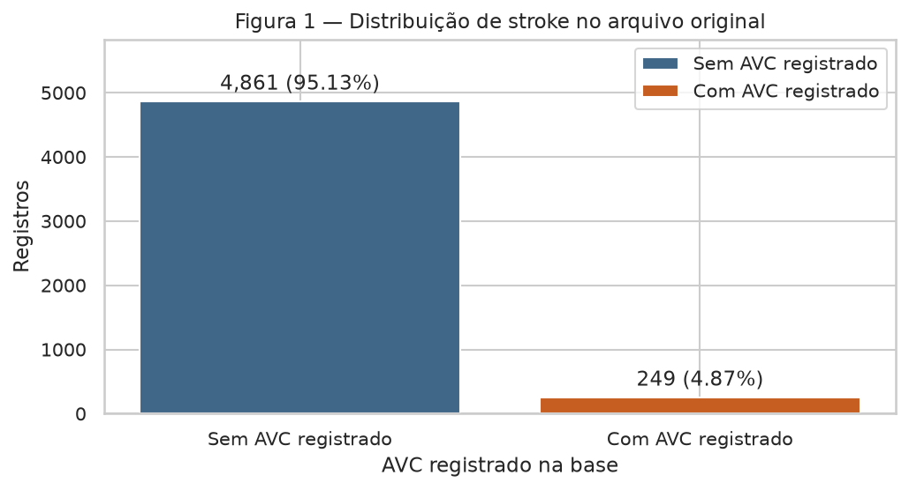
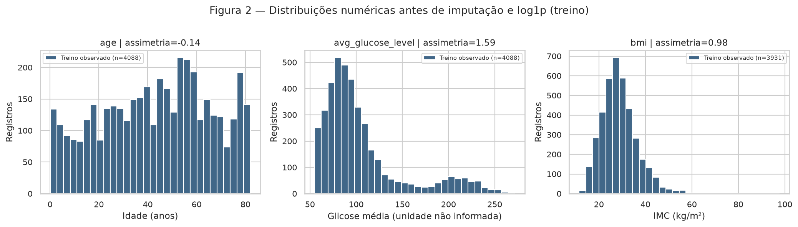
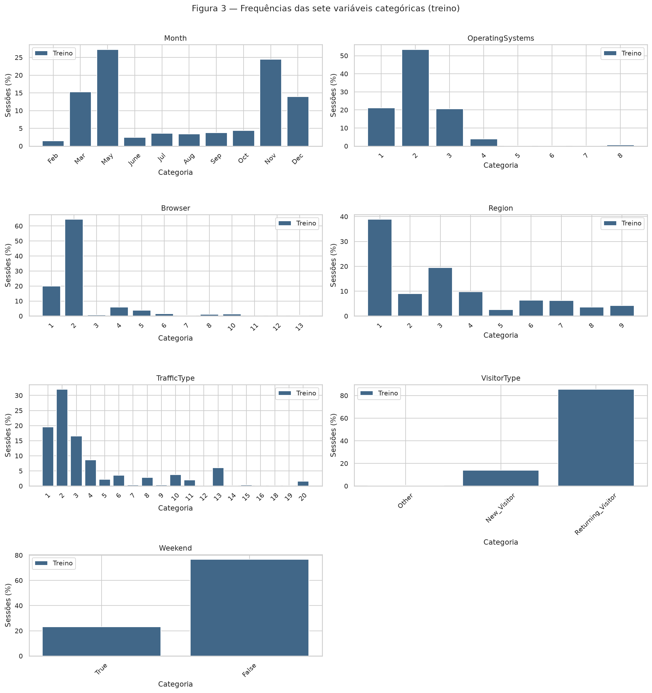
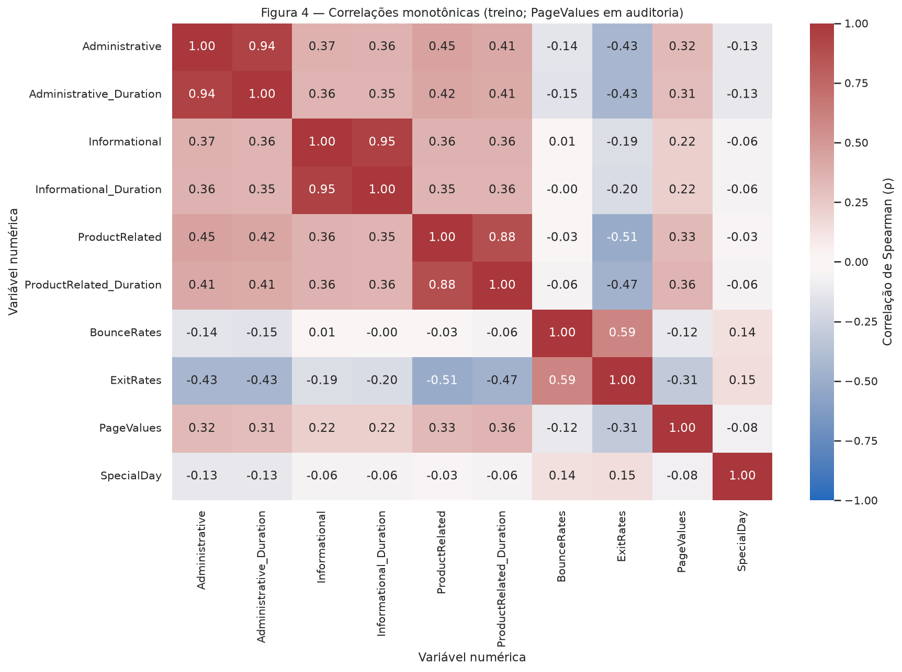
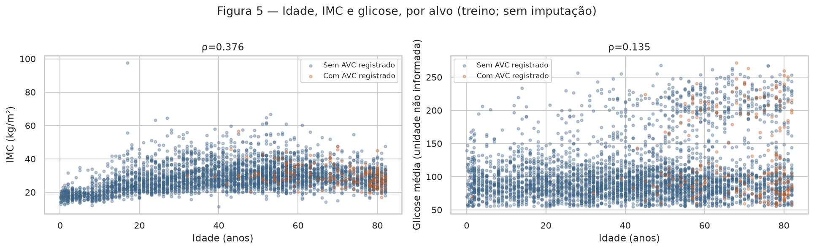
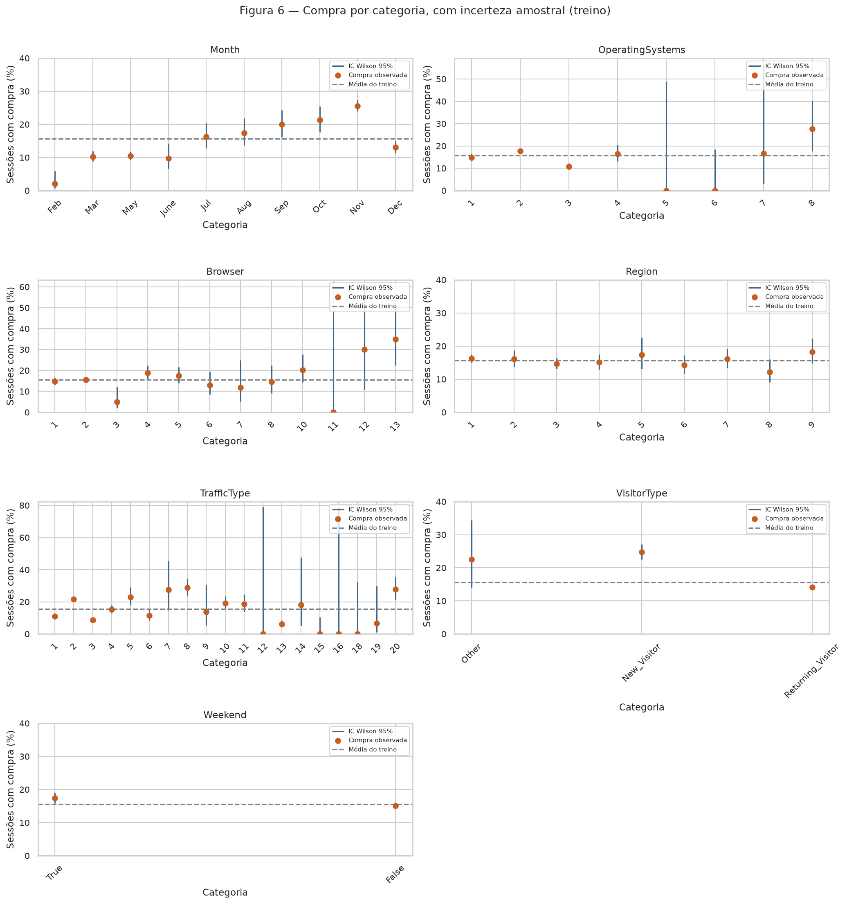
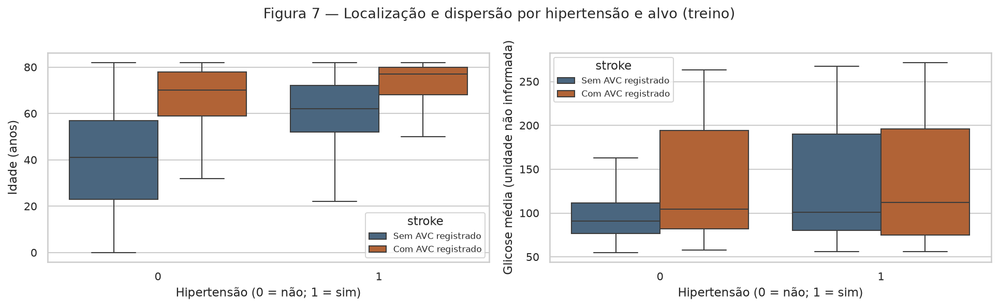
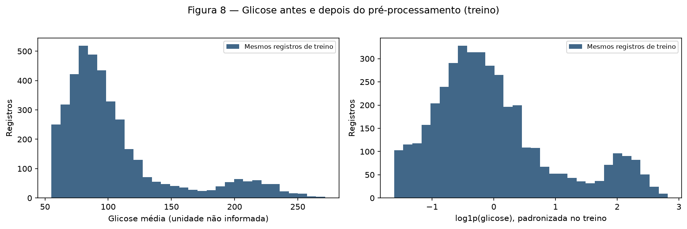
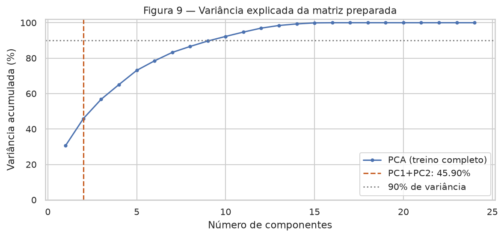

# Projeto 1 — Análise exploratória de registros de AVC

**Pergunta:** quais características registradas se associam ao indicador `stroke`?
A tarefa é classificação binária: 1 indica AVC registrado e 0 indica ausência desse registro.
O objetivo desta entrega é entender os dados e preparar um pipeline para uma futura rede neural;
nenhum classificador é treinado e nenhuma métrica de desempenho preditivo é alegada.

A base **Stroke Prediction** é um dos exemplos de classificação explicitamente linkados no
[enunciado](https://insper.github.io/ann-dl/2026.2/projects/eda/#0-proposal). Ela foi selecionada pelo assistente
entre os exemplos; a escolha específica ainda pode ser confirmada ou alterada pelo aluno.
[Conferência com as aulas e exercícios](course_alignment.md).
**Uso de IA:** implementação, redação e interpretações foram produzidas com OpenAI Codex;
os números são resultados de execução, e a revisão e compreensão pelo aluno continuam necessárias.

**Escopo:** estudo educacional e observacional. Não há data de coleta, instante do AVC ou horizonte
preditivo: não interpretamos associações como risco futuro, causalidade ou recomendação clínica.

Referências: [enunciado e rubrica](https://insper.github.io/ann-dl/2026.2/projects/eda/),
[formato de entrega](https://insper.github.io/ann-dl/2026.2/exercises/submission/),
[fonte dos dados](https://www.kaggle.com/datasets/fedesoriano/stroke-prediction-dataset),
[metadados oficiais do Kaggle](https://www.kaggle.com/api/v1/datasets/view/fedesoriano/stroke-prediction-dataset),
[OneHotEncoder](https://scikit-learn.org/stable/modules/generated/sklearn.preprocessing.OneHotEncoder.html)
e [parâmetros do UMAP](https://umap-learn.readthedocs.io/en/latest/parameters.html).

## 0. Proposal

**Base escolhida: Stroke Prediction Dataset, de fedesoriano, Kaggle, versão 1.**
O arquivo tem **5.110 linhas × 12 colunas**, correspondendo a **10 atributos úteis
(3 numéricos e 7 categóricos)**, um identificador e o alvo. Atende aos requisitos de porte, tipos
mistos, disponibilidade pública e alvo presente no arquivo.

A base permite estudar desbalanceamento forte, dados ausentes e associações entre idade,
características registradas e o indicador de AVC. A combinação de variáveis numéricas e categóricas
é adequada para investigar preparação de entradas para uma rede neural. O primeiro risco é a
origem confidencial e a ausência de datas, que impedem verificar disponibilidade dos atributos
antes do desfecho ou representatividade da população.

[Proposta completa e vínculo com o enunciado](proposal.md). A página apresenta exemplos de bases e
uma regra geral de aprovação; não publica decisões individuais sobre equipes. Registramos a seleção
feita pelo assistente, sem inventar comprovante de envio de formulário ou aprovação individual.
A mesma base será mantida na futura entrega de classificação.

## 1. Initial inspection

### A. Data dictionary

Cada linha descreve um registro individual, com características e indicador de AVC. A fonte não
identifica a instituição ou o desenho de coleta. O download é o ZIP oficial do Kaggle, fixado na
versão 1; o CSV é conferido pelo SHA-256 `644d473b05d2797006bd94865e4f8bb057f0c721617911613c82c8fcfc707420` antes da leitura.

**Tabela 1 — Dicionário de todas as 12 colunas.** Flags 0/1 são categorias; `id` não é um preditor.

| Variável          | Significado                                              | Tipo semântico     | Unidade                  |
|:------------------|:---------------------------------------------------------|:-------------------|:-------------------------|
| id                | Identificador do registro; descartado                    | Identificador      | código                   |
| gender            | Categoria de gênero registrada                           | Categórica nominal | Male / Female / Other    |
| age               | Idade; valores fracionários também ocorrem               | Numérica contínua  | anos                     |
| hypertension      | Hipertensão registrada                                   | Categórica binária | 0 = não; 1 = sim         |
| heart_disease     | Doença cardíaca registrada                               | Categórica binária | 0 = não; 1 = sim         |
| ever_married      | Se a pessoa já foi casada                                | Categórica binária | No / Yes                 |
| work_type         | Tipo de trabalho; children e Never_worked são categorias | Categórica nominal | categoria                |
| Residence_type    | Residência rural ou urbana                               | Categórica binária | Rural / Urban            |
| avg_glucose_level | Glicose média registrada                                 | Numérica contínua  | unidade não documentada  |
| bmi               | Índice de massa corporal (IMC)                           | Numérica contínua  | kg/m² (definição de IMC) |
| smoking_status    | Tabagismo; Unknown significa informação indisponível     | Categórica nominal | categoria                |
| stroke            | Registro de AVC; alvo da classificação                   | Categórica binária | 0 = não; 1 = sim         |

A unidade de glicose não está explicitada na descrição da fonte; preservamos a escala e não aplicamos
limiares clínicos. Idade fracionária é mantida, inclusive abaixo de um ano. O campo `bmi` é interpretado
como IMC; não há dados de peso e altura para recalculá-lo. `Govt_job` é o código efetivamente presente
no CSV. `Unknown` em tabagismo não significa nunca ter fumado.

**Atribuição e uso:** fedesoriano, *Stroke Prediction Dataset*, Kaggle (2021), versão 1. Os metadados
atribuem os direitos dos arquivos aos autores originais e indicam uso educacional, com fonte
confidencial. Não atribuímos CC0 ou CC BY à base. O CSV bruto não é redistribuído pelo repositório;
a reprodução faz download diretamente da fonte.

### B. Quality

**Tabela 2 — Ausência e cardinalidade antes do tratamento.** `ausentes` conta NaN de armazenamento;
`ausencia_declarada` inclui também `Unknown`, descrito como informação indisponível pela fonte.

| variavel          |   ausentes_n |   ausentes_pct |   ausencia_declarada_n |   ausencia_declarada_pct |   cardinalidade |
|:------------------|-------------:|---------------:|-----------------------:|-------------------------:|----------------:|
| id                |        0.000 |          0.000 |                  0.000 |                    0.000 |        5110.000 |
| gender            |        0.000 |          0.000 |                  0.000 |                    0.000 |           3.000 |
| age               |        0.000 |          0.000 |                  0.000 |                    0.000 |         104.000 |
| hypertension      |        0.000 |          0.000 |                  0.000 |                    0.000 |           2.000 |
| heart_disease     |        0.000 |          0.000 |                  0.000 |                    0.000 |           2.000 |
| ever_married      |        0.000 |          0.000 |                  0.000 |                    0.000 |           2.000 |
| work_type         |        0.000 |          0.000 |                  0.000 |                    0.000 |           5.000 |
| Residence_type    |        0.000 |          0.000 |                  0.000 |                    0.000 |           2.000 |
| avg_glucose_level |        0.000 |          0.000 |                  0.000 |                    0.000 |        3979.000 |
| bmi               |      201.000 |          3.933 |                201.000 |                    3.933 |         418.000 |
| smoking_status    |        0.000 |          0.000 |               1544.000 |                   30.215 |           4.000 |
| stroke            |        0.000 |          0.000 |                  0.000 |                    0.000 |           2.000 |

Há **201 valores NaN em `bmi` (3,93%)** e
**1.544 registros `Unknown` em tabagismo
(30,22%)**. Assim, a maior ausência de informação
é tabagismo, embora o maior número de NaN seja em IMC. Não confundimos essas duas definições.
Há **0 duplicatas excedentes** considerando os 10 atributos e o alvo,
sem o identificador; restam **5.110 linhas**. Nenhuma coluna é constante.

**Tabela 3 — Regras de integridade e domínio, definidas antes da análise de distribuições.**
Os NaN de IMC são contabilizados na Tabela 2, não como violação de positividade.

| regra                       |   n |
|:----------------------------|----:|
| id repetido                 |   0 |
| age < 0 ou > 120            |   0 |
| avg_glucose_level <= 0      |   0 |
| bmi <= 0 (entre observados) |   0 |
| hypertension fora de 0/1    |   0 |
| heart_disease fora de 0/1   |   0 |

Não há violação dessas regras. Isso não comprova exatidão de medição: valores muito altos de IMC
ou glicose são auditados como caudas, sem substituição por uma hipótese clínica não documentada.

**Colunas descartadas e vazamento:** `id` é removido porque identifica o registro e não descreve
um fenômeno generalizável; `stroke` é separado como alvo. Os demais campos não contêm uma cópia
explícita do alvo, mas a ausência de datas impede atestar que hipertensão, doença cardíaca e demais
informações foram coletadas antes do AVC. A tarefa atual é descrever o alvo registrado. Para uma
aplicação prospectiva será necessário obter a cronologia e auditar esse risco.

### C. Target

**Tabela 4 — Distribuição das duas classes em cada partição.**

| particao       |   classe |    n |    pct |
|:---------------|---------:|-----:|-------:|
| bruto          |        0 | 4861 | 95.127 |
| bruto          |        1 |  249 |  4.873 |
| sem_duplicatas |        0 | 4861 | 95.127 |
| sem_duplicatas |        1 |  249 |  4.873 |
| treino         |        0 | 3889 | 95.132 |
| treino         |        1 |  199 |  4.868 |
| teste          |        0 |  972 | 95.108 |
| teste          |        1 |   50 |  4.892 |

São **249 registros positivos (4,87%)** e
**4.861 negativos (95,13%)**;
a razão é **19.52 negativos por positivo**.
Uma regra constante de classe 0 teria acurácia de **95,13%**,
sem identificar nenhum positivo. Esse número deriva das frequências, sem treinar um modelo.



**Conclusão da Figura 1:** o forte desbalanceamento torna acurácia isolada pouco informativa;
na modelagem futura serão necessários PR-AUC, recall, precisão e matriz de confusão.

### D. Train and test

A regra de exclusão de `id` e a deduplicação são determinísticas e não estimam parâmetros.
Depois delas, antes de decisões baseadas em distribuições, fixamos a primeira divisão de
`StratifiedGroupKFold(n_splits=5, shuffle=True, random_state=42)`. O grupo é o hash dos 10 atributos,
sem `id` nem alvo: perfis iguais, mesmo com alvos divergentes, permanecem juntos.
Há **5.110 perfis distintos** e **0 linhas
além do primeiro registro por perfil**. Uma asserção confirma zero perfis compartilhados.

O treino contém **4.088 linhas (80,00%)** e o teste,
**1.022 (20,00%)**. A frequência positiva é
**4,87% no treino** e **4,89% no teste**:
a estratificação por grupos é aproximada. A [lista de linhas e partições](tables/split.csv)
permite auditoria. `source_row` é índice de rastreamento (zero-based, sem cabeçalho), nunca atributo.

Não há datas para uma divisão temporal real, nem identificador de pessoa validado que permita
verificar reincidência. Essa divisão não demonstra desempenho em períodos futuros. As seções 2–4
usam exclusivamente o treino; o teste recebe apenas a transformação ajustada e checagens de contrato.

## 2. Univariate analysis

### A. Numerical

**Tabela 5 — Estatísticas dos três atributos numéricos no treino, antes da imputação.**
Média, mediana, desvio amostral, quartis e P99 são calculados somente entre valores observados;
`n observado` explicita o denominador de cada coluna. Tabelas usam ponto decimal.

|                   |   n observado |   ausentes |   média |   mediana |   desvio |    mín |     Q1 |      Q3 |     P99 |     máx |   assimetria |
|:------------------|--------------:|-----------:|--------:|----------:|---------:|-------:|-------:|--------:|--------:|--------:|-------------:|
| age               |      4088.000 |      0.000 |  43.374 |    45.000 |   22.534 |  0.080 | 25.000 |  61.000 |  81.130 |  82.000 |       -0.142 |
| avg_glucose_level |      4088.000 |      0.000 | 106.069 |    91.925 |   45.023 | 55.120 | 77.498 | 114.060 | 242.649 | 271.740 |        1.592 |
| bmi               |      3931.000 |    157.000 |  28.838 |    28.100 |    7.692 | 11.500 | 23.500 |  32.900 |  52.800 |  97.600 |        0.976 |



**Conclusão da Figura 2:** idade ocupa uma faixa ampla e tem assimetria pequena; glicose e IMC
apresentam caudas à direita. São medidas de formas diferentes, não três variáveis normais equivalentes.

- **age:** média 43.374, mediana 45.000, assimetria -0.142, máximo 82.000. Assimetria pequena; idade não é tomada como distribuição normal. O bin mais frequente é [51.963, 54.693], com 216 observações; isso é uma moda por intervalo, não uma moda exata.
- **avg_glucose_level:** média 106.069, mediana 91.925, assimetria 1.592, máximo 271.740. A média excede a mediana e há cauda à direita; log1p comprime essa cauda. O bin mais frequente é [76.782, 84.003], com 519 observações; isso é uma moda por intervalo, não uma moda exata.
- **bmi:** média 28.838, mediana 28.100, assimetria 0.976, máximo 97.600. A média excede a mediana e há cauda à direita; log1p comprime essa cauda. O bin mais frequente é [25.850, 28.720], com 694 observações; isso é uma moda por intervalo, não uma moda exata.

Os painéis usam 30 bins na escala original para expor forma e extremos sem ocultar a unidade.
Os picos dependem dos bins; não inferimos um número exato de modas nem subpopulações clínicas a
partir do histograma. Os valores de IMC ausentes não entram no histograma. A auditoria IQR é
quantificada na seção 4A, e não remove automaticamente valores altos.

### B. Categorical

**Tabela 6 — Cardinalidade e número de níveis raros (<1% do treino).**

| variavel       |   cardinalidade |   categorias_raras |
|:---------------|----------------:|-------------------:|
| gender         |               3 |                  1 |
| hypertension   |               2 |                  0 |
| heart_disease  |               2 |                  0 |
| ever_married   |               2 |                  0 |
| work_type      |               5 |                  1 |
| Residence_type |               2 |                  0 |
| smoking_status |               4 |                  0 |

**Tabela 7 — Frequências completas de todas as sete variáveis categóricas.**

| variavel       | categoria       |    n |    pct | rara_menos_1pct   |
|:---------------|:----------------|-----:|-------:|:------------------|
| gender         | Female          | 2413 | 59.026 | False             |
| gender         | Male            | 1674 | 40.949 | False             |
| gender         | Other           |    1 |  0.024 | True              |
| hypertension   | 0               | 3708 | 90.705 | False             |
| hypertension   | 1               |  380 |  9.295 | False             |
| heart_disease  | 0               | 3867 | 94.594 | False             |
| heart_disease  | 1               |  221 |  5.406 | False             |
| ever_married   | Yes             | 2687 | 65.729 | False             |
| ever_married   | No              | 1401 | 34.271 | False             |
| work_type      | Private         | 2370 | 57.975 | False             |
| work_type      | Self-employed   |  635 | 15.533 | False             |
| work_type      | children        |  534 | 13.063 | False             |
| work_type      | Govt_job        |  533 | 13.038 | False             |
| work_type      | Never_worked    |   16 |  0.391 | True              |
| Residence_type | Urban           | 2055 | 50.269 | False             |
| Residence_type | Rural           | 2033 | 49.731 | False             |
| smoking_status | never smoked    | 1518 | 37.133 | False             |
| smoking_status | Unknown         | 1250 | 30.577 | False             |
| smoking_status | formerly smoked |  704 | 17.221 | False             |
| smoking_status | smokes          |  616 | 15.068 | False             |



**Conclusão da Figura 3:** os níveis têm suportes distintos e há categorias raras;
nenhum atributo tem alta cardinalidade (máximo **5 níveis**).
One-hot é viável sem impor ordem aos códigos ou agregar grupos pequenos arbitrariamente.

- **gender:** 3 categorias; mais frequente `Female` (n=2.413; 59,03%). Categorias com frequência <1%: `Other`.
- **hypertension:** 2 categorias; mais frequente `0` (n=3.708; 90,70%). Categorias com frequência <1%: nenhuma.
- **heart_disease:** 2 categorias; mais frequente `0` (n=3.867; 94,59%). Categorias com frequência <1%: nenhuma.
- **ever_married:** 2 categorias; mais frequente `Yes` (n=2.687; 65,73%). Categorias com frequência <1%: nenhuma.
- **work_type:** 5 categorias; mais frequente `Private` (n=2.370; 57,97%). Categorias com frequência <1%: `Never_worked`.
- **Residence_type:** 2 categorias; mais frequente `Urban` (n=2.055; 50,27%). Categorias com frequência <1%: nenhuma.
- **smoking_status:** 4 categorias; mais frequente `never smoked` (n=1.518; 37,13%). Categorias com frequência <1%: nenhuma.

`gender=Other` tem suporte insuficiente para concluir algo sobre esse grupo. `Unknown` em tabagismo
é mantido como categoria explícita: imputá-lo como nunca fumou mudaria o significado do dado.

## 3. Bivariate and multivariate analysis

### A. Numerical × numerical

Usamos **Spearman**, porque glicose e IMC têm caudas e a associação com idade pode ser monotônica,
sem ser linear. Empates recebem ranks médios. A correlação usa pares completos observados,
sem preencher IMC com a mediana para criar artificialmente repetições.
A [matriz completa em CSV](tables/correlation.csv) permite conferir os valores sem arredondamento visual.



**Conclusão da Figura 4:** o maior par é **age × bmi**, com
**ρ=0.376325**, entre **3.931 pares completos**. A associação é moderada;
nenhum par indica redundância quase perfeita que justifique descartar um dos três atributos.

**Tabela 8 — Todos os três pares, ordenados pelo valor absoluto de ρ.**

| variavel_1        | variavel_2        |      rho |   n_pares_completos |
|:------------------|:------------------|---------:|--------------------:|
| age               | bmi               | 0.376325 |                3931 |
| age               | avg_glucose_level | 0.135232 |                4088 |
| avg_glucose_level | bmi               | 0.117418 |                3931 |



**Conclusão da Figura 5:** há dispersão dentro de cada idade e sobreposição das classes; as relações
não são cópias determinísticas. A nuvem de IMC não inclui os registros ausentes. Idade e glicose
têm ρ=0.135232, menor que o maior par da Tabela 8.
Preservamos os três atributos e avaliamos suas contribuições apenas na modelagem posterior.

### B. Categorical × target

**Tabela 9 — Frequência de AVC registrado por categoria, com denominadores e intervalo Wilson 95%.**
São estimativas descritivas por grupo, sem ajuste por idade, confundimento ou comparações múltiplas;
não são probabilidades populacionais nem inferências causais.

| variavel       | categoria       |    n |   avc_n |   taxa_pct |   wilson_low_pct |   wilson_high_pct |
|:---------------|:----------------|-----:|--------:|-----------:|-----------------:|------------------:|
| gender         | Male            | 1674 |      88 |      5.257 |            4.287 |             6.432 |
| gender         | Other           |    1 |       0 |      0.000 |            0.000 |            79.346 |
| gender         | Female          | 2413 |     111 |      4.600 |            3.834 |             5.511 |
| hypertension   | 0               | 3708 |     152 |      4.099 |            3.507 |             4.786 |
| hypertension   | 1               |  380 |      47 |     12.368 |            9.430 |            16.060 |
| heart_disease  | 0               | 3867 |     163 |      4.215 |            3.626 |             4.895 |
| heart_disease  | 1               |  221 |      36 |     16.290 |           12.004 |            21.727 |
| ever_married   | No              | 1401 |      22 |      1.570 |            1.039 |             2.366 |
| ever_married   | Yes             | 2687 |     177 |      6.587 |            5.710 |             7.589 |
| work_type      | Private         | 2370 |     119 |      5.021 |            4.212 |             5.975 |
| work_type      | Govt_job        |  533 |      28 |      5.253 |            3.659 |             7.488 |
| work_type      | children        |  534 |       1 |      0.187 |            0.033 |             1.053 |
| work_type      | Never_worked    |   16 |       0 |      0.000 |            0.000 |            19.361 |
| work_type      | Self-employed   |  635 |      51 |      8.031 |            6.161 |            10.406 |
| Residence_type | Rural           | 2033 |      96 |      4.722 |            3.882 |             5.733 |
| Residence_type | Urban           | 2055 |     103 |      5.012 |            4.150 |             6.042 |
| smoking_status | smokes          |  616 |      30 |      4.870 |            3.432 |             6.867 |
| smoking_status | Unknown         | 1250 |      38 |      3.040 |            2.223 |             4.145 |
| smoking_status | never smoked    | 1518 |      73 |      4.809 |            3.842 |             6.004 |
| smoking_status | formerly smoked |  704 |      58 |      8.239 |            6.427 |            10.503 |



**Conclusão da Figura 6:** as frequências variam entre grupos, mas categorias pequenas têm intervalos
amplos; 0 positivos em um grupo pequeno não demonstra risco nulo. Entre categorias com n≥100:

- **gender:** entre níveis com n≥100, 4,60% em `Female` (n=2.413) a 5,26% em `Male` (n=1.674).
- **hypertension:** entre níveis com n≥100, 4,10% em `0` (n=3.708) a 12,37% em `1` (n=380).
- **heart_disease:** entre níveis com n≥100, 4,22% em `0` (n=3.867) a 16,29% em `1` (n=221).
- **ever_married:** entre níveis com n≥100, 1,57% em `No` (n=1.401) a 6,59% em `Yes` (n=2.687).
- **work_type:** entre níveis com n≥100, 0,19% em `children` (n=534) a 8,03% em `Self-employed` (n=635).
- **Residence_type:** entre níveis com n≥100, 4,72% em `Rural` (n=2.033) a 5,01% em `Urban` (n=2.055).
- **smoking_status:** entre níveis com n≥100, 3,04% em `Unknown` (n=1.250) a 8,24% em `formerly smoked` (n=704).

Diferenças em `ever_married` e `work_type` podem refletir a composição etária; não interpretamos
casamento ou trabalho como causa de AVC. O mesmo cuidado vale para comorbidades e tabagismo.

### C. Numerical × categorical

Os boxplots confrontam idade e glicose com hipertensão, separando também o alvo. Caixas mostram
Q1, mediana e Q3; whiskers usam 1,5 IQR. Pontos externos são ocultados apenas no desenho,
sem excluir registros ou limitar valores na análise.



**Tabela 10 — Localização e dispersão por hipertensão, agregando as classes.**

|   hypertension | variavel          |    n |     q1 |   mediana |      q3 |     IQR |
|---------------:|:------------------|-----:|-------:|----------:|--------:|--------:|
|              0 | age               | 3708 | 23.000 |    42.000 |  59.000 |  36.000 |
|              0 | avg_glucose_level | 3708 | 77.198 |    91.265 | 112.197 |  35.000 |
|              1 | age               |  380 | 53.000 |    63.000 |  74.000 |  21.000 |
|              1 | avg_glucose_level |  380 | 79.192 |   100.660 | 191.022 | 111.830 |

**Conclusão da Figura 7:** a diferença entre grupos envolve localização e dispersão. No grupo com
hipertensão, idade tem mediana maior e IQR menor; glicose tem mediana maior e IQR maior. Logo,
comparar apenas médias ou assumir dispersão igual esconderia estrutura observada no treino.

- **age:** hipertensão=0: mediana 42.000, IQR 36.000; hipertensão=1: mediana 63.000, IQR 21.000.
- **avg_glucose_level:** hipertensão=0: mediana 91.265, IQR 35.000; hipertensão=1: mediana 100.660, IQR 111.830.

## 4. Preprocessing

### A. Strategies

**Tabela 11 — Ausência de IMC e tabagismo no treino, por classe.**

|   stroke |        n |   bmi_ausente_n |   bmi_ausente_pct |   tabagismo_unknown_n |   tabagismo_unknown_pct |
|---------:|---------:|----------------:|------------------:|----------------------:|------------------------:|
|    0.000 | 3889.000 |         124.000 |             3.188 |              1212.000 |                  31.165 |
|    1.000 |  199.000 |          33.000 |            16.583 |                38.000 |                  19.095 |

A ausência não tem a mesma frequência nas duas classes; isso não permite afirmar que seja aleatória.
Não descartamos linhas com IMC ausente, pois isso alteraria a composição do alvo.

| Decisão | Evidência e implementação |
| --- | --- |
| Ausentes numéricos | Há 201 NaN no bruto (Tabela 2) e **157 no treino**. A mediana de IMC aprendida só no treino é **28.100**; ela preenche IMC antes de log1p. O indicador `missing__missingindicator_bmi` preserva a ausência em 0/1 (Tabela 11). |
| Ausentes categóricos | `Unknown` em tabagismo é informação indisponível e permanece como nível próprio (Tabelas 2 e 7). Para um NaN futuro em categóricos, imputamos o texto `Ausente`, sem trocar por uma categoria conhecida. |
| Outliers | Glicose e IMC têm caudas (Tabela 5, Figura 2). Usamos `log1p` nessas duas colunas e preservamos todos os registros; limites IQR abaixo são diagnósticos. Idade permanece sem log. |
| Codificação | As sete categorias têm no máximo 5 níveis (Tabela 6). One-hot mantém todos os níveis conhecidos; `handle_unknown='ignore'` transforma nível inédito em zeros naquele bloco. |
| Escala | Idade, glicose e IMC têm unidades e dispersões diferentes (Tabela 5). StandardScaler usa médias/desvios do treino, após log1p nas duas colunas de cauda e diretamente na idade. |
| Descarte | `id` é identificador (Tabela 1); `stroke` fica exclusivamente como alvo. |

**Tabela 12 — Auditoria de outliers no treino: fora de [Q1−1,5×IQR, Q3+1,5×IQR].**

|                   |     q1 |      q3 |   limiar_inferior |   limiar_superior |   fora_IQR_n |
|:------------------|-------:|--------:|------------------:|------------------:|-------------:|
| age               | 25.000 |  61.000 |           -29.000 |           115.000 |        0.000 |
| avg_glucose_level | 77.498 | 114.060 |            22.654 |           168.904 |      492.000 |
| bmi               | 23.500 |  32.900 |             9.400 |            47.000 |       89.000 |

Há **561 linhas de treino** fora de pelo menos um limite.
Foram **0 linhas removidas e 0 limitadas** por esse diagnóstico. Log1p altera ao menos uma entrada
em **4.088 linhas**, inclusive as que não ultrapassam IQR.
Isso comprime caudas continuamente, sem declarar que um extremo válido é erro.

Indicadores one-hot e o indicador de IMC ausente ficam em 0/1, sem padronização para não amplificar
níveis raros. As três medidas numéricas ficam com variância unitária após transformação. Essa escolha
de ponderação dá mais peso às medidas contínuas na distância euclidiana; deve ser considerada na
leitura das projeções e revisada em validação futura, sem consultar o teste.



**Conclusão da Figura 8:** log1p comprime a cauda da glicose; a padronização posterior
centraliza e muda a escala, sem mudar novamente a forma. Os dois painéis mostram os mesmos
registros, com bins nas respectivas unidades. Um histograma mais simétrico não comprova melhora
preditiva: log1p é uma escolha inicial a comparar com a escala original em validação interna
do treino, como enfatiza a aula de transformações. Nenhum modelo foi avaliado nesta entrega.

### B. Dimensionality reduction

PCA recebe a matriz preparada de **4.088 registros de treino**, sem alvo nem `id`.
Para comparar mapas fixamos a mesma amostra estratificada de **2.000 registros de treino** com seed 42.
A estratificação serve à representatividade visual; o alvo somente colore pontos e nunca é passado
ao ajuste de PCA, t-SNE ou UMAP.

Parâmetros: PCA com SVD completa; t-SNE com perplexity **15 e 50**, inicialização PCA,
learning_rate automático, 1.000 iterações; UMAP com n_neighbors **15 e 50**, min_dist 0.1,
distância euclidiana. Todos os random_state e transform_seed explícitos são **42**, com uma thread.



**Conclusão da Figura 9:** PC1 explica **30,68%**, PC2
**15,22%**; juntas, **45,90%**.
São necessárias **10 componentes** para pelo menos 90%. O mapa 2D deixa informação de fora.

**Tabela 13 — Cinco maiores pesos absolutos por componente.** Aqui loadings significa pesos de
`components_`, não correlações variável-componente. O sinal global de uma PC pode inverter sem mudar
a geometria. [Todos os pesos](tables/pca_weights.csv).

| componente   | feature                    |      peso |
|:-------------|:---------------------------|----------:|
| PC1          | direct__age                |  0.627627 |
| PC1          | log__bmi                   |  0.543130 |
| PC1          | log__avg_glucose_level     |  0.303625 |
| PC1          | category__ever_married_No  | -0.255684 |
| PC1          | category__ever_married_Yes |  0.255684 |
| PC2          | log__avg_glucose_level     |  0.943027 |
| PC2          | log__bmi                   | -0.200298 |
| PC2          | direct__age                | -0.154372 |
| PC2          | category__ever_married_Yes | -0.092388 |
| PC2          | category__ever_married_No  |  0.092388 |

- **PC1:** maiores pesos positivos entre os três principais: `direct__age`, `log__bmi`, `log__avg_glucose_level`; negativos: nenhum. Pesos do mesmo sinal contribuem no mesmo sentido para a coordenada; sinais opostos se contrapõem. Isso não prova correlação entre as variáveis originais.
- **PC2:** maiores pesos positivos entre os três principais: `log__avg_glucose_level`; negativos: `log__bmi`, `direct__age`. Pesos do mesmo sinal contribuem no mesmo sentido para a coordenada; sinais opostos se contrapõem. Isso não prova correlação entre as variáveis originais.

Esses pesos descrevem combinações de idade, medidas transformadas e categorias, não causas do
alvo nem importância preditiva. O indicador de ausência é lido como característica de registro.


**Conclusão da Figura 10:** mapas não lineares revelam concentrações locais que o mapa linear
sobrepõe, mas a distribuição visual muda com os parâmetros e as classes continuam misturadas.
Tamanho das ilhas e distância entre ilhas em t-SNE/UMAP não medem prevalência nem dissimilaridade global.
Não usamos uma ilha como diagnóstico, classe descoberta ou prova de desempenho de modelo.

**Tabela 14 — Trustworthiness em 10 vizinhos, na mesma amostra e no espaço preparado.**
Valores próximos de 1 indicam menos vizinhos espúrios introduzidos pelo mapa, sem medir separação de
classes ou generalização. [Coordenadas e índices dos cinco mapas](tables/projections.csv).

| projecao   |    n |   vizinhos_avaliacao |   trustworthiness |
|:-----------|-----:|---------------------:|------------------:|
| PCA        | 2000 |                   10 |          0.814860 |
| t-SNE p=15 | 2000 |                   10 |          0.986933 |
| t-SNE p=50 | 2000 |                   10 |          0.985577 |
| UMAP k=15  | 2000 |                   10 |          0.978924 |
| UMAP k=50  | 2000 |                   10 |          0.972131 |

PCA obtém **0.814860**; t-SNE (15/50),
**0.986933 / 0.985577**; UMAP (15/50),
**0.978924 / 0.972131**.
A comparação quantifica preservação local; não seleciona um preditor. Mesmo uma projeção com
vizinhanças bem preservadas pode manter forte sobreposição do alvo.

### C. Pipeline

`code/preprocessing.py` é importável e retorna uma `Pipeline` com `ColumnTransformer`.
`analyze.py` ajusta uma única vez por `fit_transform(X_train)` e chama somente `transform(X_test)`.
Imputação, médias, desvios e vocabulários categóricos são aprendidos exclusivamente no treino.

**Tabela 15 — Contrato executado e verificado.**

| Verificação | Resultado |
| --- | --- |
| Treino antes/depois | 4088 × 10 → (4088, 24) |
| Teste antes/depois | 1022 × 10 → (1022, 24) |
| NaN ou infinitos nas saídas | 0 em ambas |
| Perfis compartilhados entre partições | 0 |
| Categoria real inédita no teste | Nenhuma |
| Categoria sintética Nunca_observado em work_type | saída finita; mesmo shape; bloco work_type todo zero |
| NaN sintético em bmi e gender | saída finita, com imputação e indicador de IMC |

Como nenhum nível de referência foi descartado, um bloco todo zero para uma categoria inédita não
se confunde com uma categoria conhecida de referência. A identidade da categoria nova é perdida;
é necessário monitorar níveis inéditos na entrada. O indicador de ausência de IMC tem dimensão fixa,
inclusive se um fold não tiver IMC ausente. Os casos sintéticos não modificam a base real.

**Tabela 16 — Nomes e ordem de todas as 24 colunas finais.**

|   posição (0-based) | feature                                  |
|--------------------:|:-----------------------------------------|
|                   0 | log__avg_glucose_level                   |
|                   1 | log__bmi                                 |
|                   2 | direct__age                              |
|                   3 | missing__missingindicator_bmi            |
|                   4 | category__gender_Female                  |
|                   5 | category__gender_Male                    |
|                   6 | category__gender_Other                   |
|                   7 | category__hypertension_0                 |
|                   8 | category__hypertension_1                 |
|                   9 | category__heart_disease_0                |
|                  10 | category__heart_disease_1                |
|                  11 | category__ever_married_No                |
|                  12 | category__ever_married_Yes               |
|                  13 | category__work_type_Govt_job             |
|                  14 | category__work_type_Never_worked         |
|                  15 | category__work_type_Private              |
|                  16 | category__work_type_Self-employed        |
|                  17 | category__work_type_children             |
|                  18 | category__Residence_type_Rural           |
|                  19 | category__Residence_type_Urban           |
|                  20 | category__smoking_status_Unknown         |
|                  21 | category__smoking_status_formerly smoked |
|                  22 | category__smoking_status_never smoked    |
|                  23 | category__smoking_status_smokes          |

**Tabela 17 — Faixas e momentos finais das três medidas numéricas.**

| particao   | feature                |       min |      max |     media |   std_ddof0 |
|:-----------|:-----------------------|----------:|---------:|----------:|------------:|
| treino     | direct__age            | -1.921520 | 1.714299 | -0.000000 |    1.000000 |
| treino     | log__avg_glucose_level | -1.615684 | 2.820765 |  0.000000 |    1.000000 |
| treino     | log__bmi               | -3.400128 | 4.974174 | -0.000000 |    1.000000 |
| teste      | direct__age            | -1.917969 | 1.714299 | -0.032814 |    1.016999 |
| teste      | log__avg_glucose_level | -1.596251 | 2.767273 | -0.001870 |    1.032009 |
| teste      | log__bmi               | -3.809351 | 4.737090 |  0.015612 |    1.075850 |

StandardScaler usa desvio populacional (ddof=0): a média é aproximadamente zero e o desvio
é um no treino; isso não é uma exigência para o teste. As médias/desvios descritivos da Tabela 5
usam dados observados e desvio amostral, portanto não devem ser confundidos com estes valores.
A padronização não limita a saída a [-1,1]. O exercício 3 aceita StandardScaler ou MinMaxScaler;
esta EDA usa a primeira alternativa. Não afirmamos que a faixa seja limitada nem que tanh esteja
livre de saturação; avaliar a ativação e uma alternativa MinMax em validação pertence à modelagem.
One-hot e indicador de ausência continuam em 0/1; o [CSV completo](tables/scaling_checks.csv)
permite conferir as faixas numéricas sem inferir parâmetros do teste.

Os testes comparam medianas, médias e vocabulários com o treino, transformam um teste sintético com
valores extremos e verificam que o estado ajustado não muda. Também verificam o descarte de `id` e
alvo, grupos, integridade do CSV, indicador de ausência e links dos arquivos no site compilado.
[Como reproduzir](reproduce.md).

```python
--8<-- "docs/projects/eda/code/preprocessing.py"
```

## 5. Synthesis

Para quem preparará o modelo:

- **Desbalanceamento:** só 4,87% dos registros são positivos
  (Tabela 4, Figura 1). Usar métricas adequadas e validação estratificada dentro do treino; pesos,
  reamostragem e escolha de limiar pertencem aos folds de treino/validação, sem consultar o teste.
- **Ausência informativa:** IMC tem 201 ausentes no bruto e tabagismo tem
  1.544 Unknown (Tabela 2). As frequências variam por alvo no treino
  (Tabela 11). Mediana preserva o tamanho da matriz; o indicador e Unknown sinalizam ausência, sem recuperar o valor real;
  monitorar esses padrões em novos dados e revisar sua origem.
- **Caudas e escalas:** Tabela 5 e Figura 2 justificam log1p em glicose/IMC e padronização.
  561 registros ultrapassam limites IQR (Tabela 12), mas não foram
  excluídos sem evidência de erro. Revisar extremos com a fonte, sem impor limiares clínicos inventados.
- **Associações e confundimento:** maior correlação numérica é 0.376325 (Tabela 8, Figuras 4–5).
  Tabelas 9–10 e Figuras 6–7 mostram diferenças por grupos que podem refletir idade e composição
  amostral. Não transformar associação em causalidade ou usar categoria rara como regra conclusiva.
- **Redução:** PC1+PC2 preserva 45,90% da variância (Figura 9).
  A Figura 10 e Tabela 14 comparam preservação local e sensibilidade dos mapas, sem evidência de
  separação perfeita. O pipeline final preserva todas as colunas preparadas; redução não é obrigatória.
- **Origem e temporalidade:** a fonte é confidencial e não há datas. Antes de qualquer alegação de
  previsão futura, obter cronologia, representatividade, critérios de rótulo e disponibilidade prévia
  dos atributos. A EDA atual se limita a registros observados para finalidade educacional.

A base foi escolhida dentre os exemplos explicitamente indicados no enunciado, por seleção do assistente; a confirmação específica pelo aluno permanece em aberto. Código, relatório, figuras e tabelas são versionados; dados brutos são obtidos da fonte
com versão e hash fixados. O README e o front matter declaram integralmente o uso de IA.

### Results summary

|   # | Resumo dos resultados                            | Valor                                                                             |
|----:|:-------------------------------------------------|:----------------------------------------------------------------------------------|
|   1 | Dataset, tarefa e alvo                           | Stroke Prediction (fedesoriano, Kaggle, v1); classificação; stroke                |
|   2 | Instâncias × atributos (numéricos / categóricos) | 5.110 × 12 colunas no CSV; 10 atributos (3 / 7), mais id e alvo; id descartado    |
|   3 | Coluna com mais ausentes e percentual            | Ausência declarada: smoking_status, 1.544 Unknown (30,22%); NaN: bmi, 201 (3,93%) |
|   4 | Colunas descartadas e motivo                     | id: identificador; stroke separado como alvo                                      |
|   5 | Classe minoritária (%)                           | stroke=1: 249 (4,87%)                                                             |
|   6 | Tamanhos de treino e teste                       | 4.088 / 1.022; seed=42; estratificação por perfis                                 |
|   7 | Par numérico mais correlacionado e valor         | age × bmi; Spearman ρ=0.376325; n=3931                                            |
|   8 | Linhas afetadas pela estratégia de outliers      | Treino: 561 sinalizadas por IQR; 0 removidas/limitadas; 4.088 alteradas por log1p |
|   9 | Variância explicada por PC1 + PC2                | 45,90%                                                                            |
|  10 | Shape de treino e teste após pipeline            | (4088, 24) / (1022, 24); 0 NaN e 0 infinitos                                      |
