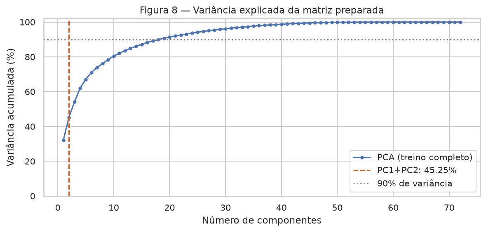
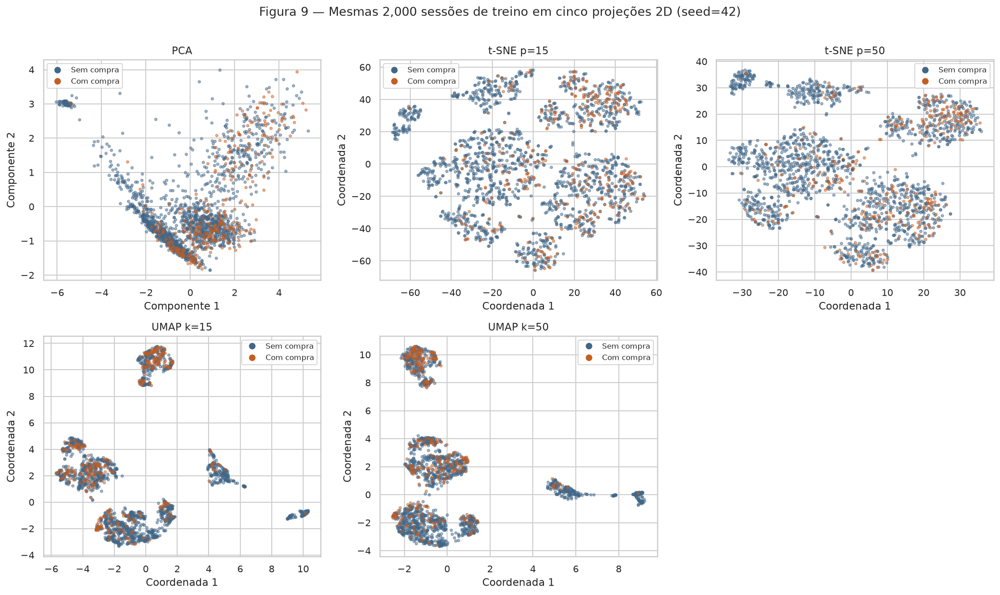

# Projeto 1 — Análise exploratória de intenção de compra

Este projeto investiga **quais características de navegação se associam à compra em uma sessão**.
O alvo discreto é `Revenue` (0/1). O produto desta entrega é um pipeline para uma futura rede neural;
nenhum classificador foi treinado e não há estimativa de desempenho preditivo.

**Escopo de uso:** classificação retrospectiva de sessões completas. O CSV não contém eventos
intermediários nem o instante da compra, portanto esta análise não demonstra previsão em tempo real.
As seções 2–4 usam **somente o treino**; o teste é usado para conferir o contrato de transformação.

**Transparência:** este trabalho foi feito usando inteligência artificial, inclusive a redação das
interpretações. Cada número abaixo é calculado pelo código versionado, sem resultados inventados.
É necessário estudar e revisar as decisões antes de defender o trabalho.

**Referências:** [enunciado e rubrica](https://insper.github.io/ann-dl/2026.2/projects/eda/),
[formato de entrega](https://insper.github.io/ann-dl/2026.2/exercises/submission/),
[fonte primária UCI](https://archive.ics.uci.edu/dataset/468/online+shoppers+purchasing+intention+dataset), [DOI](https://doi.org/10.24432/C5F88Q),
[OneHotEncoder](https://scikit-learn.org/stable/modules/generated/sklearn.preprocessing.OneHotEncoder.html),
[parâmetros do UMAP](https://umap-learn.readthedocs.io/en/latest/parameters.html).
Tabelas e gráficos foram produzidos por esta implementação, sem reutilizar análises de terceiros.

## 0. Proposal

A proposta é usar **Online Shoppers Purchasing Intention**, de C. Sakar e Yomi Kastro (2018),
licença [CC BY 4.0](https://creativecommons.org/licenses/by/4.0/).
O arquivo tem **12.330 sessões × 18 colunas**: 10 atributos numéricos,
7 categóricos e o alvo binário. É público, tabular, tem mais de 1.000 linhas e mais de 5 atributos.
Não é uma das bases clássicas expressamente vedadas no enunciado.

O problema combina comportamento de navegação, calendário e contexto do visitante, permitindo
estudar caudas longas, desbalanceamento e relações não lineares. O primeiro risco é que `PageValues`
envolve atribuição de valor a transações: sem sua data de cálculo, não é seguro usá-lo como preditor.

**Status acadêmico: proposta preparada; aprovação do professor não comprovada.** A disciplina exige
aprovação da base como pré-requisito; esta entrega técnica não substitui essa aprovação nem o registro
no formulário. [Proposta pronta para revisão e envio](proposal.md).

## 1. Initial inspection

### A. Data dictionary

Uma linha corresponde ao resumo de uma sessão. A UCI informa que a construção buscou sessões de
usuários distintos em um período de um ano; o CSV não oferece IDs para verificar essa independência.
O download usa o ZIP oficial e verifica o SHA-256 `b3055ee355f59134d851d32641183cb4a8b45def7124d2f50442a042f358e0d9`.

**Tabela 1 — Dicionário das 18 colunas originais.** Tipos semânticos prevalecem sobre o dtype do CSV.

| Variável                | Significado                                                                | Tipo semântico     | Unidade                    |
|:------------------------|:---------------------------------------------------------------------------|:-------------------|:---------------------------|
| Administrative          | Páginas administrativas visitadas                                          | Numérica discreta  | páginas                    |
| Administrative_Duration | Tempo acumulado em páginas administrativas                                 | Numérica contínua  | tempo¹                     |
| Informational           | Páginas informativas visitadas                                             | Numérica discreta  | páginas                    |
| Informational_Duration  | Tempo acumulado em páginas informativas                                    | Numérica contínua  | tempo¹                     |
| ProductRelated          | Páginas de produtos visitadas                                              | Numérica discreta  | páginas                    |
| ProductRelated_Duration | Tempo acumulado em páginas de produtos                                     | Numérica contínua  | tempo¹                     |
| BounceRates             | Taxa de rejeição das páginas visitadas, segundo Analytics                  | Numérica contínua  | fração [0, 1]              |
| ExitRates               | Taxa de saída das páginas visitadas, segundo Analytics                     | Numérica contínua  | fração [0, 1]              |
| PageValues              | Valor médio atribuído às páginas antes de transações; excluído do pipeline | Numérica contínua  | valor; moeda não informada |
| SpecialDay              | Proximidade de uma data comercial especial                                 | Numérica ordinal   | índice [0, 1]              |
| Month                   | Mês da sessão; códigos originais, inclusive June                           | Categórica nominal | mês                        |
| OperatingSystems        | Código de sistema operacional, sem ordem semântica                         | Categórica nominal | código                     |
| Browser                 | Código do navegador, sem ordem semântica                                   | Categórica nominal | código                     |
| Region                  | Código da região, sem identificação geográfica no arquivo                  | Categórica nominal | código                     |
| TrafficType             | Código de origem de tráfego                                                | Categórica nominal | código                     |
| VisitorType             | Visitante novo, recorrente ou Other                                        | Categórica nominal | categoria                  |
| Weekend                 | Se a sessão ocorreu no fim de semana                                       | Categórica binária | True / False               |
| Revenue                 | Se a sessão resultou em compra; alvo                                       | Categórica binária | 0 = não; 1 = sim           |

¹ As durações são quantidades de tempo; a página da UCI e o CSV não explicitam a unidade. Mantemos
a escala original e não afirmamos segundos. `PageValues` também não informa moeda.
`SpecialDay` tem ordem, mas intervalos comerciais não necessariamente equivalentes; tratá-lo como
índice numérico é uma hipótese simples a revisar na modelagem. Os códigos de sistema, navegador,
região e tráfego são strings nominais no pipeline. Janeiro e abril não aparecem; não criamos sessões
ou observações nesses meses. `June` é preservado como código da fonte.

### B. Quality

**Tabela 2 — Ausentes por coluna (contagem e percentual), antes de qualquer tratamento.**

| variavel                |   ausentes_n |   ausentes_pct |   cardinalidade |
|:------------------------|-------------:|---------------:|----------------:|
| Administrative          |        0.000 |          0.000 |          27.000 |
| Administrative_Duration |        0.000 |          0.000 |        3335.000 |
| Informational           |        0.000 |          0.000 |          17.000 |
| Informational_Duration  |        0.000 |          0.000 |        1258.000 |
| ProductRelated          |        0.000 |          0.000 |         311.000 |
| ProductRelated_Duration |        0.000 |          0.000 |        9551.000 |
| BounceRates             |        0.000 |          0.000 |        1872.000 |
| ExitRates               |        0.000 |          0.000 |        4777.000 |
| PageValues              |        0.000 |          0.000 |        2704.000 |
| SpecialDay              |        0.000 |          0.000 |           6.000 |
| Month                   |        0.000 |          0.000 |          10.000 |
| OperatingSystems        |        0.000 |          0.000 |           8.000 |
| Browser                 |        0.000 |          0.000 |          13.000 |
| Region                  |        0.000 |          0.000 |           9.000 |
| TrafficType             |        0.000 |          0.000 |          20.000 |
| VisitorType             |        0.000 |          0.000 |           3.000 |
| Weekend                 |        0.000 |          0.000 |           2.000 |
| Revenue                 |        0.000 |          0.000 |           2.000 |

Há **0 valores ausentes**, e todas as colunas empatam em 0% de ausência.
Há **125 duplicatas exatas excedentes** (1,01%),
removidas por regra determinística, restando **12.205 linhas**. Isso trata repetições
como redundância de registro; sessões distintas podem ter o mesmo resumo, então a deduplicação
também muda ligeiramente a população de análise. Não há identificador ou coluna constante a descartar.

**Tabela 3 — Auditoria de domínio no arquivo original.** Taxas fora de [0,1], contagens negativas
ou fracionárias e duração positiva com contagem zero são verificadas explicitamente.

| regra                                        |   n |
|:---------------------------------------------|----:|
| Administrative < 0                           |   0 |
| Administrative_Duration < 0                  |   0 |
| Informational < 0                            |   0 |
| Informational_Duration < 0                   |   0 |
| ProductRelated < 0                           |   0 |
| ProductRelated_Duration < 0                  |   0 |
| BounceRates < 0                              |   0 |
| ExitRates < 0                                |   0 |
| PageValues < 0                               |   0 |
| SpecialDay < 0                               |   0 |
| BounceRates > 1                              |   0 |
| ExitRates > 1                                |   0 |
| SpecialDay > 1                               |   0 |
| Administrative não inteiro                   |   0 |
| Informational não inteiro                    |   0 |
| ProductRelated não inteiro                   |   0 |
| Administrative=0 e Administrative_Duration>0 |   0 |
| Informational=0 e Informational_Duration>0   |   0 |
| ProductRelated=0 e ProductRelated_Duration>0 |   0 |

Todas as regras da Tabela 3 resultam em zero violações. Isso não comprova ausência de erro de medição.

**Vazamento:** `Revenue` fica separado do conjunto de entrada. `PageValues` é excluído preventivamente,
porque a definição da UCI envolve transações e não há metadados temporais que atestem cálculo anterior
ao desfecho. Não afirmamos que todo valor seja vazamento comprovado. `BounceRates` e `ExitRates`
também são agregados de Analytics com janela desconhecida: permanecem para análise retrospectiva,
mas uma aplicação futura precisará recomputá-los com dados históricos anteriores ao desfecho.
`source_row`, criado apenas para rastrear a divisão, nunca é atributo.

### C. Target

**Tabela 4 — Contagem e percentual das classes em cada população.**

| particao       |   classe |     n |    pct |
|:---------------|---------:|------:|-------:|
| bruto          |        0 | 10422 | 84.526 |
| bruto          |        1 |  1908 | 15.474 |
| sem_duplicatas |        0 | 10297 | 84.367 |
| sem_duplicatas |        1 |  1908 | 15.633 |
| treino         |        0 |  8238 | 84.371 |
| treino         |        1 |  1526 | 15.629 |
| teste          |        0 |  2059 | 84.351 |
| teste          |        1 |   382 | 15.649 |

No bruto há **1.908 compras (15,47%)** e
**10.422 não compras (84,53%)**,
razão de 5.46 não compras por compra.
Na base sem duplicatas a minoria é **15,63%**. Uma regra constante de “não compra” teria
acurácia de 84,37%, sem detectar compra alguma; esse é um cálculo
da frequência de classes, não uma avaliação de modelo.


**Conclusão da Figura 1:** compras são minoritárias; na futura modelagem, usar PR-AUC,
recall e matriz de confusão, além de acurácia, com limiar escolhido em validação interna do treino.

### D. Train and test

Depois das regras determinísticas de integridade e exclusão por domínio, antes de analisar
distribuições ou estimar imputação/escala, aplicamos `StratifiedGroupKFold(n_splits=5, shuffle=True,
random_state=42)` e fixamos **a primeira divisão**, sem escolher a que parece melhor.
O grupo é o hash dos 16 atributos retidos, sem `Revenue` e sem `PageValues`. Assim, vetores de
entrada iguais, inclusive com alvos diferentes, não atravessam a divisão. Há **12.205
perfis distintos** e **0 linhas além do primeiro registro de cada perfil**
mesmo após retirar duplicatas completas. A separação entre esses perfis é verificada por asserção.

O treino tem **9.764 linhas (80,00%)**, e o teste,
**2.441 (20,00%)**. A estratificação por grupos é aproximada:
as taxas de compra são **15,63% no treino** e
**15,65% no teste**. A [lista de índices e partições](tables/split.csv)
permite auditar a separação; os índices começam em zero, excluindo o cabeçalho do CSV.

A divisão aleatória estima generalização entre sessões intercambiáveis do mesmo período. Como só
há o mês, sem ano/dia/ID, não conseguimos garantir uma avaliação temporal real. Não apresentamos
essa divisão como evidência de desempenho em meses futuros. O teste não participa das seções 2–4,
exceto na transformação final e na checagem de categorias inéditas.

## 2. Univariate analysis

### A. Numerical

**Tabela 5 — Estatísticas de todos os 10 atributos numéricos no treino.** `PageValues` aparece
apenas para auditoria, embora não seja usado pelo pipeline. O desvio é amostral; quartis e P99
seguem o cálculo padrão do pandas. Os decimais das tabelas usam ponto.

|                         |        n |    média |   mediana |   desvio |   mín |      Q1 |       Q3 |      P99 |       máx |   assimetria |   zeros (%) |
|:------------------------|---------:|---------:|----------:|---------:|------:|--------:|---------:|---------:|----------:|-------------:|------------:|
| Administrative          | 9764.000 |    2.332 |     1.000 |    3.315 | 0.000 |   0.000 |    4.000 |   14.000 |    27.000 |        1.937 |      46.303 |
| Administrative_Duration | 9764.000 |   81.180 |     9.000 |  173.957 | 0.000 |   0.000 |   95.000 |  845.533 |  2720.500 |        5.274 |      47.388 |
| Informational           | 9764.000 |    0.510 |     0.000 |    1.276 | 0.000 |   0.000 |    0.000 |    6.000 |    24.000 |        4.014 |      78.605 |
| Informational_Duration  | 9764.000 |   34.518 |     0.000 |  139.164 | 0.000 |   0.000 |    0.000 |  699.300 |  2256.917 |        7.442 |      80.449 |
| ProductRelated          | 9764.000 |   31.944 |    18.000 |   44.384 | 0.000 |   8.000 |   38.000 |  222.000 |   705.000 |        4.282 |       0.277 |
| ProductRelated_Duration | 9764.000 | 1197.728 |   599.417 | 1842.777 | 0.000 | 192.500 | 1465.689 | 8864.825 | 43171.233 |        5.066 |       5.213 |
| BounceRates             | 9764.000 |    0.020 |     0.003 |    0.045 | 0.000 |   0.000 |    0.017 |    0.200 |     0.200 |        3.156 |      45.217 |
| ExitRates               | 9764.000 |    0.042 |     0.025 |    0.046 | 0.000 |   0.014 |    0.050 |    0.200 |     0.200 |        2.225 |       0.604 |
| PageValues              | 9764.000 |    5.830 |     0.000 |   18.467 | 0.000 |   0.000 |    0.000 |   85.200 |   361.764 |        6.491 |      77.888 |
| SpecialDay              | 9764.000 |    0.060 |     0.000 |    0.196 | 0.000 |   0.000 |    0.000 |    1.000 |     1.000 |        3.334 |      89.963 |

Escolhemos uma única figura em painéis para não confundir quantidade de gráficos com evidência.
A escala symlog e os bins espaçados em log1p tornam visíveis a concentração próxima de zero e as
caudas; os rótulos continuam na unidade original. O treino não é alterado para desenhar a figura.


**Conclusão da Figura 2:** os picos em zero e as caudas à direita tornam média e mediana diferentes;
normalidade e remoção automática de valores grandes não são boas hipóteses iniciais.
As leituras individuais, incluindo assimetria e concentração em zero, são:

- **Administrative:** mediana 1.000, média 2.332, assimetria 1.937 e 46,30% de zeros: cauda à direita. O pico em zero representa ausência de navegação nesse tipo de página.
- **Administrative_Duration:** mediana 9.000, média 81.180, assimetria 5.274 e 47,39% de zeros: cauda à direita. O pico em zero representa ausência de navegação nesse tipo de página.
- **Informational:** mediana 0.000, média 0.510, assimetria 4.014 e 78,61% de zeros: cauda à direita. O pico em zero representa ausência de navegação nesse tipo de página.
- **Informational_Duration:** mediana 0.000, média 34.518, assimetria 7.442 e 80,45% de zeros: cauda à direita. O pico em zero representa ausência de navegação nesse tipo de página.
- **ProductRelated:** mediana 18.000, média 31.944, assimetria 4.282 e 0,28% de zeros: cauda à direita. O pico em zero representa ausência de navegação nesse tipo de página.
- **ProductRelated_Duration:** mediana 599.417, média 1197.728, assimetria 5.066 e 5,21% de zeros: cauda à direita. O pico em zero representa ausência de navegação nesse tipo de página.
- **BounceRates:** mediana 0.003, média 0.020, assimetria 3.156 e 45,22% de zeros: cauda à direita. Não interpretamos a distribuição como normal.
- **ExitRates:** mediana 0.025, média 0.042, assimetria 2.225 e 0,60% de zeros: cauda à direita. Não interpretamos a distribuição como normal.
- **PageValues:** mediana 0.000, média 5.830, assimetria 6.491 e 77,89% de zeros: cauda à direita. Não interpretamos a distribuição como normal.
- **SpecialDay:** mediana 0.000, média 0.060, assimetria 3.334 e 89,96% de zeros: cauda à direita. Não interpretamos a distribuição como normal.

Os histogramas permitem reconhecer concentração e caudas, mas não estabelecem um número exato de
modas: ele depende dos bins. Especialmente nas durações, zeros são valores válidos e não são
convertidos em ausentes. A auditoria de extremos com limites IQR está na seção 4A.

### B. Categorical

**Tabela 6 — Cardinalidade e número de categorias raras (<1% do treino).**

| variavel         |   cardinalidade |   categorias_raras |
|:-----------------|----------------:|-------------------:|
| Month            |              10 |                  0 |
| OperatingSystems |               8 |                  4 |
| Browser          |              12 |                  5 |
| Region           |               9 |                  0 |
| TrafficType      |              19 |                  8 |
| VisitorType      |               3 |                  1 |
| Weekend          |               2 |                  0 |

**Tabela 7 — Frequências completas por categoria (nenhum nível omitido).**

| variavel         | categoria         |    n |    pct | rara_menos_1pct   |
|:-----------------|:------------------|-----:|-------:|:------------------|
| Month            | May               | 2662 | 27.263 | False             |
| Month            | Nov               | 2387 | 24.447 | False             |
| Month            | Mar               | 1490 | 15.260 | False             |
| Month            | Dec               | 1363 | 13.959 | False             |
| Month            | Oct               |  432 |  4.424 | False             |
| Month            | Sep               |  366 |  3.748 | False             |
| Month            | Jul               |  350 |  3.585 | False             |
| Month            | Aug               |  333 |  3.410 | False             |
| Month            | June              |  236 |  2.417 | False             |
| Month            | Feb               |  145 |  1.485 | False             |
| OperatingSystems | 2                 | 5220 | 53.462 | False             |
| OperatingSystems | 1                 | 2056 | 21.057 | False             |
| OperatingSystems | 3                 | 2016 | 20.647 | False             |
| OperatingSystems | 4                 |  387 |  3.964 | False             |
| OperatingSystems | 8                 |   58 |  0.594 | True              |
| OperatingSystems | 6                 |   17 |  0.174 | True              |
| OperatingSystems | 7                 |    6 |  0.061 | True              |
| OperatingSystems | 5                 |    4 |  0.041 | True              |
| Browser          | 2                 | 6287 | 64.390 | False             |
| Browser          | 1                 | 1941 | 19.879 | False             |
| Browser          | 4                 |  581 |  5.950 | False             |
| Browser          | 5                 |  382 |  3.912 | False             |
| Browser          | 6                 |  146 |  1.495 | False             |
| Browser          | 10                |  138 |  1.413 | False             |
| Browser          | 8                 |  110 |  1.127 | False             |
| Browser          | 3                 |   80 |  0.819 | True              |
| Browser          | 13                |   43 |  0.440 | True              |
| Browser          | 7                 |   42 |  0.430 | True              |
| Browser          | 12                |   10 |  0.102 | True              |
| Browser          | 11                |    4 |  0.041 | True              |
| Region           | 1                 | 3795 | 38.867 | False             |
| Region           | 3                 | 1897 | 19.429 | False             |
| Region           | 4                 |  953 |  9.760 | False             |
| Region           | 2                 |  882 |  9.033 | False             |
| Region           | 6                 |  624 |  6.391 | False             |
| Region           | 7                 |  608 |  6.227 | False             |
| Region           | 9                 |  406 |  4.158 | False             |
| Region           | 8                 |  346 |  3.544 | False             |
| Region           | 5                 |  253 |  2.591 | False             |
| TrafficType      | 2                 | 3125 | 32.005 | False             |
| TrafficType      | 1                 | 1907 | 19.531 | False             |
| TrafficType      | 3                 | 1613 | 16.520 | False             |
| TrafficType      | 4                 |  849 |  8.695 | False             |
| TrafficType      | 13                |  592 |  6.063 | False             |
| TrafficType      | 10                |  364 |  3.728 | False             |
| TrafficType      | 6                 |  351 |  3.595 | False             |
| TrafficType      | 8                 |  277 |  2.837 | False             |
| TrafficType      | 5                 |  214 |  2.192 | False             |
| TrafficType      | 11                |  194 |  1.987 | False             |
| TrafficType      | 20                |  151 |  1.546 | False             |
| TrafficType      | 15                |   33 |  0.338 | True              |
| TrafficType      | 7                 |   29 |  0.297 | True              |
| TrafficType      | 9                 |   29 |  0.297 | True              |
| TrafficType      | 19                |   15 |  0.154 | True              |
| TrafficType      | 14                |   11 |  0.113 | True              |
| TrafficType      | 18                |    8 |  0.082 | True              |
| TrafficType      | 12                |    1 |  0.010 | True              |
| TrafficType      | 16                |    1 |  0.010 | True              |
| VisitorType      | Returning_Visitor | 8347 | 85.488 | False             |
| VisitorType      | New_Visitor       | 1355 | 13.878 | False             |
| VisitorType      | Other             |   62 |  0.635 | True              |
| Weekend          | False             | 7493 | 76.741 | False             |
| Weekend          | True              | 2271 | 23.259 | False             |


**Conclusão da Figura 3:** a massa é desigual entre meses, visitantes e códigos; categorias pequenas
precisam de cautela. A maior cardinalidade é **19**,
portanto não há coluna com centenas de níveis que inviabilize one-hot neste conjunto.

- **Month:** 10 categorias; a mais frequente é `May` (2.662 sessões; 27,26%). Categorias com frequência <1%: nenhuma.
- **OperatingSystems:** 8 categorias; a mais frequente é `2` (5.220 sessões; 53,46%). Categorias com frequência <1%: `8`, `6`, `7`, `5`.
- **Browser:** 12 categorias; a mais frequente é `2` (6.287 sessões; 64,39%). Categorias com frequência <1%: `3`, `13`, `7`, `12`, `11`.
- **Region:** 9 categorias; a mais frequente é `1` (3.795 sessões; 38,87%). Categorias com frequência <1%: nenhuma.
- **TrafficType:** 19 categorias; a mais frequente é `2` (3.125 sessões; 32,01%). Categorias com frequência <1%: `15`, `7`, `9`, `19`, `14`, `18`, `12`, `16`.
- **VisitorType:** 3 categorias; a mais frequente é `Returning_Visitor` (8.347 sessões; 85,49%). Categorias com frequência <1%: `Other`.
- **Weekend:** 2 categorias; a mais frequente é `False` (7.493 sessões; 76,74%). Categorias com frequência <1%: nenhuma.

Não agregamos automaticamente categorias raras: a dimensão é pequena e a categoria pode ser
informativa. Na modelagem, avaliar regularização e estabilidade em validação, sem tomar o código
numérico como escala contínua.

## 3. Bivariate and multivariate analysis

### A. Numerical × numerical

Usamos **Spearman**, pois há assimetria, zeros, caudas longas e relações possivelmente monotônicas,
sem exigir relação linear nas unidades originais. Empates recebem ranks médios. A matriz completa
está na Figura 4 e no [CSV de correlações](tables/correlation.csv).


**Conclusão da Figura 4:** o maior par é **Informational × Informational_Duration**, com
**ρ=0.951342**. Há redundância entre medidas de volume e duração, e entre taxas,
que precisa ser considerada ao interpretar importância de variáveis.

**Tabela 8 — Seis maiores correlações em valor absoluto, excluindo diagonal e pares repetidos.**

| variavel_1              | variavel_2              |       rho |
|:------------------------|:------------------------|----------:|
| Informational           | Informational_Duration  |  0.951342 |
| Administrative          | Administrative_Duration |  0.939653 |
| ProductRelated          | ProductRelated_Duration |  0.881070 |
| BounceRates             | ExitRates               |  0.594511 |
| ProductRelated          | ExitRates               | -0.508250 |
| ProductRelated_Duration | ExitRates               | -0.466164 |


**Conclusão da Figura 5:** o volume de páginas e a duração crescem juntos
(ρ=0.881070), e rejeição e saída
também se associam (ρ=0.594511). A dispersão
residual e a sobreposição das classes impedem tratá-los como cópias ou separadores perfeitos.
Preservamos ambos inicialmente e planejamos ablação/regularização em validação futura.

### B. Categorical × target

**Tabela 9 — Compra por todos os níveis categóricos**, com denominador, compras e intervalo Wilson
de 95%. Os intervalos descrevem incerteza binomial por grupo; não corrigem comparações múltiplas,
dependência ou confundimento. Não são testes de causalidade nem seleção automática de atributos.

| variavel         | categoria         |    n |   compras |   taxa_pct |   wilson_low_pct |   wilson_high_pct |
|:-----------------|:------------------|-----:|----------:|-----------:|-----------------:|------------------:|
| Month            | Feb               |  145 |         3 |      2.069 |            0.706 |             5.906 |
| Month            | Mar               | 1490 |       153 |     10.268 |            8.828 |            11.913 |
| Month            | May               | 2662 |       278 |     10.443 |            9.338 |            11.663 |
| Month            | June              |  236 |        23 |      9.746 |            6.582 |            14.199 |
| Month            | Jul               |  350 |        57 |     16.286 |           12.787 |            20.516 |
| Month            | Aug               |  333 |        58 |     17.417 |           13.722 |            21.856 |
| Month            | Sep               |  366 |        73 |     19.945 |           16.173 |            24.342 |
| Month            | Oct               |  432 |        92 |     21.296 |           17.697 |            25.401 |
| Month            | Nov               | 2387 |       611 |     25.597 |           23.886 |            27.386 |
| Month            | Dec               | 1363 |       178 |     13.059 |           11.374 |            14.953 |
| OperatingSystems | 1                 | 2056 |       305 |     14.835 |           13.364 |            16.437 |
| OperatingSystems | 2                 | 5220 |       923 |     17.682 |           16.671 |            18.741 |
| OperatingSystems | 3                 | 2016 |       217 |     10.764 |            9.485 |            12.192 |
| OperatingSystems | 4                 |  387 |        64 |     16.537 |           13.168 |            20.564 |
| OperatingSystems | 5                 |    4 |         0 |      0.000 |            0.000 |            48.990 |
| OperatingSystems | 6                 |   17 |         0 |      0.000 |            0.000 |            18.432 |
| OperatingSystems | 7                 |    6 |         1 |     16.667 |            3.005 |            56.351 |
| OperatingSystems | 8                 |   58 |        16 |     27.586 |           17.752 |            40.205 |
| Browser          | 1                 | 1941 |       287 |     14.786 |           13.277 |            16.435 |
| Browser          | 2                 | 6287 |       972 |     15.460 |           14.588 |            16.375 |
| Browser          | 3                 |   80 |         4 |      5.000 |            1.961 |            12.162 |
| Browser          | 4                 |  581 |       110 |     18.933 |           15.955 |            22.319 |
| Browser          | 5                 |  382 |        67 |     17.539 |           14.054 |            21.671 |
| Browser          | 6                 |  146 |        19 |     13.014 |            8.492 |            19.432 |
| Browser          | 7                 |   42 |         5 |     11.905 |            5.194 |            25.001 |
| Browser          | 8                 |  110 |        16 |     14.545 |            9.156 |            22.328 |
| Browser          | 10                |  138 |        28 |     20.290 |           14.427 |            27.762 |
| Browser          | 11                |    4 |         0 |      0.000 |            0.000 |            48.990 |
| Browser          | 12                |   10 |         3 |     30.000 |           10.779 |            60.323 |
| Browser          | 13                |   43 |        15 |     34.884 |           22.418 |            49.828 |
| Region           | 1                 | 3795 |       615 |     16.206 |           15.067 |            17.412 |
| Region           | 2                 |  882 |       142 |     16.100 |           13.822 |            18.672 |
| Region           | 3                 | 1897 |       278 |     14.655 |           13.135 |            16.318 |
| Region           | 4                 |  953 |       144 |     15.110 |           12.977 |            17.524 |
| Region           | 5                 |  253 |        44 |     17.391 |           13.218 |            22.540 |
| Region           | 6                 |  624 |        89 |     14.263 |           11.737 |            17.226 |
| Region           | 7                 |  608 |        98 |     16.118 |           13.410 |            19.253 |
| Region           | 8                 |  346 |        42 |     12.139 |            9.107 |            16.002 |
| Region           | 9                 |  406 |        74 |     18.227 |           14.775 |            22.274 |
| TrafficType      | 1                 | 1907 |       209 |     10.960 |            9.635 |            12.441 |
| TrafficType      | 2                 | 3125 |       678 |     21.696 |           20.286 |            23.175 |
| TrafficType      | 3                 | 1613 |       140 |      8.679 |            7.402 |            10.153 |
| TrafficType      | 4                 |  849 |       130 |     15.312 |           13.046 |            17.890 |
| TrafficType      | 5                 |  214 |        49 |     22.897 |           17.775 |            28.975 |
| TrafficType      | 6                 |  351 |        40 |     11.396 |            8.481 |            15.147 |
| TrafficType      | 7                 |   29 |         8 |     27.586 |           14.699 |            45.717 |
| TrafficType      | 8                 |  277 |        80 |     28.881 |           23.861 |            34.478 |
| TrafficType      | 9                 |   29 |         4 |     13.793 |            5.497 |            30.559 |
| TrafficType      | 10                |  364 |        70 |     19.231 |           15.512 |            23.593 |
| TrafficType      | 11                |  194 |        36 |     18.557 |           13.716 |            24.619 |
| TrafficType      | 12                |    1 |         0 |      0.000 |            0.000 |            79.346 |
| TrafficType      | 13                |  592 |        37 |      6.250 |            4.568 |             8.496 |
| TrafficType      | 14                |   11 |         2 |     18.182 |            5.137 |            47.699 |
| TrafficType      | 15                |   33 |         0 |      0.000 |            0.000 |            10.427 |
| TrafficType      | 16                |    1 |         0 |      0.000 |            0.000 |            79.346 |
| TrafficType      | 18                |    8 |         0 |      0.000 |            0.000 |            32.442 |
| TrafficType      | 19                |   15 |         1 |      6.667 |            1.187 |            29.817 |
| TrafficType      | 20                |  151 |        42 |     27.815 |           21.286 |            35.444 |
| VisitorType      | Other             |   62 |        14 |     22.581 |           13.955 |            34.406 |
| VisitorType      | New_Visitor       | 1355 |       335 |     24.723 |           22.500 |            27.090 |
| VisitorType      | Returning_Visitor | 8347 |      1177 |     14.101 |           13.371 |            14.864 |
| Weekend          | True              | 2271 |       395 |     17.393 |           15.890 |            19.007 |
| Weekend          | False             | 7493 |      1131 |     15.094 |           14.301 |            15.923 |


**Conclusão da Figura 6:** há diferenças descritivas entre categorias, mas taxas extremas de grupos
pequenos vêm com intervalos amplos; não justificam uma regra comercial isolada. Comparando apenas
grupos com pelo menos 100 sessões para tornar a leitura menos instável:

- **Month:** entre categorias com ao menos 100 sessões, a taxa varia de 2,07% em `Feb` (n=145) a 25,60% em `Nov` (n=2.387). São associações observacionais, sem ajuste por outras variáveis.
- **OperatingSystems:** entre categorias com ao menos 100 sessões, a taxa varia de 10,76% em `3` (n=2.016) a 17,68% em `2` (n=5.220). São associações observacionais, sem ajuste por outras variáveis.
- **Browser:** entre categorias com ao menos 100 sessões, a taxa varia de 13,01% em `6` (n=146) a 20,29% em `10` (n=138). São associações observacionais, sem ajuste por outras variáveis.
- **Region:** entre categorias com ao menos 100 sessões, a taxa varia de 12,14% em `8` (n=346) a 18,23% em `9` (n=406). São associações observacionais, sem ajuste por outras variáveis.
- **TrafficType:** entre categorias com ao menos 100 sessões, a taxa varia de 6,25% em `13` (n=592) a 28,88% em `8` (n=277). São associações observacionais, sem ajuste por outras variáveis.
- **VisitorType:** entre categorias com ao menos 100 sessões, a taxa varia de 14,10% em `Returning_Visitor` (n=8.347) a 24,72% em `New_Visitor` (n=1.355). São associações observacionais, sem ajuste por outras variáveis.
- **Weekend:** entre categorias com ao menos 100 sessões, a taxa varia de 15,09% em `False` (n=7.493) a 17,39% em `True` (n=2.271). São associações observacionais, sem ajuste por outras variáveis.

### C. Numerical × categorical

Escolhemos `ProductRelated` e `ExitRates` para verificar se os tipos de visitante diferem em
volume e rejeição/saída. O boxplot mostra Q1, mediana e Q3, e whiskers de 1,5 IQR;
os pontos fora dos whiskers são ocultados **somente na figura**, sem excluir qualquer sessão.
As caixas separam também o alvo para evitar uma leitura baseada apenas em mistura de classes.


**Tabela 10 — Mediana e dispersão por VisitorType (classes agregadas), para quantificar a leitura.**

| VisitorType       | variavel       |    n |    q1 |   mediana |     q3 |    IQR |
|:------------------|:---------------|-----:|------:|----------:|-------:|-------:|
| New_Visitor       | ProductRelated | 1355 | 7.000 |    13.000 | 23.000 | 16.000 |
| New_Visitor       | ExitRates      | 1355 | 0.007 |     0.013 |  0.025 |  0.018 |
| Other             | ProductRelated |   62 | 2.000 |     6.000 | 14.750 | 12.750 |
| Other             | ExitRates      |   62 | 0.010 |     0.033 |  0.067 |  0.056 |
| Returning_Visitor | ProductRelated | 8347 | 8.000 |    20.000 | 41.000 | 33.000 |
| Returning_Visitor | ExitRates      | 8347 | 0.016 |     0.028 |  0.051 |  0.035 |

**Conclusão da Figura 7:** os grupos variam em localização e em dispersão; a Tabela 10 quantifica
as duas dimensões. A estratificação visual pelo alvo mostra sobreposição, então o tipo de visitante
sozinho não determina compra. `Other` tem pouco suporte, conforme Tabelas 7 e 9.

- **ProductRelated**, agregando os alvos: New_Visitor: mediana=13.000, IQR=16.000; Other: mediana=6.000, IQR=12.750; Returning_Visitor: mediana=20.000, IQR=33.000.
- **ExitRates**, agregando os alvos: New_Visitor: mediana=0.013, IQR=0.018; Other: mediana=0.033, IQR=0.056; Returning_Visitor: mediana=0.028, IQR=0.035.

## 4. Preprocessing

### A. Strategies

Cada regra é determinada pelo domínio ou pelo **treino**, sem escolher limites a partir do teste.

| Decisão | Evidência e execução |
| --- | --- |
| Ausentes | A Tabela 2 tem zero ausentes. Mantemos imputação por mediana aprendida no treino nos dois blocos numéricos, para entradas futuras; categóricos recebem `Ausente`. Não afirmamos ter corrigido ausentes reais. |
| Outliers | A Tabela 5 mostra caudas e zeros; a Tabela 11 quantifica extremos. Mantemos todos, pois sessões longas podem ser legítimas. `log1p` nas seis contagens/durações comprime as caudas e preserva zero; nenhum corte é estimado usando o teste. |
| Codificação | As Tabelas 6 e 7 mostram no máximo 19 categorias por coluna. One-hot nos sete atributos nominais, sem ordem artificial e sem remover a primeira categoria. `handle_unknown='ignore'` mantém a dimensão para um nível inédito. |
| Escala | A Tabela 5 contrapõe contagens/durações com taxas [0,1]. `StandardScaler` após log1p nas seis variáveis de navegação e diretamente nas três taxas/índices, com médias e desvios ajustados só no treino. |
| Exclusão | `PageValues` sai por risco de vazamento descrito em 1B; `Revenue` nunca entra no ajuste. As 16 entradas restantes são 9 numéricas e 7 categóricas. |

Os indicadores one-hot permanecem em 0/1. Não os padronizamos: isso evita amplificar fortemente
categorias raras. A distância euclidiana das projeções dá variância unitária às nove variáveis
numéricas e variância menor aos indicadores; essa escolha de ponderação favorece sinais numéricos
e é uma limitação explícita da comparação, não uma propriedade natural dos dados.

**Tabela 11 — Auditoria de caudas no treino: limite superior Q3 + 1,5×IQR.**
Em variáveis com muitos zeros, o IQR pode ser zero; por isso sinalizar não significa erro.

|                         |      q1 |       q3 |   limiar_superior |   acima_limiar_n |
|:------------------------|--------:|---------:|------------------:|-----------------:|
| Administrative          |   0.000 |    4.000 |            10.000 |          323.000 |
| Administrative_Duration |   0.000 |   95.000 |           237.500 |          910.000 |
| Informational           |   0.000 |    0.000 |             0.000 |         2089.000 |
| Informational_Duration  |   0.000 |    0.000 |             0.000 |         1909.000 |
| ProductRelated          |   8.000 |   38.000 |            83.000 |          793.000 |
| ProductRelated_Duration | 192.500 | 1465.689 |          3375.472 |          762.000 |

Há **2.944 linhas** do treino acima de pelo menos um desses limites.
Foram **0 linhas removidas e 0 limitadas** por essa auditoria. A transformação log1p muda pelo
menos um valor em **9.761 linhas de treino**, incluindo sessões
não sinalizadas; ela é contínua, não um filtro binário de outliers. Os limites IQR são apenas
diagnósticos e não entram em `transform`.

### B. Dimensionality reduction

Todas as projeções recebem a mesma matriz preparada, sem `PageValues` e sem alvo. PCA é ajustado
em **9.764 sessões de treino**. Para a comparação visual e os algoritmos não lineares,
fixamos uma amostra estratificada de **2.000 sessões**, com `random_state=42`; essa estratificação
serve apenas para representar a classe minoritária na visualização. Os mesmos índices aparecem nos
cinco mapas; o alvo **apenas colore** os pontos e não entra no ajuste de PCA, t-SNE ou UMAP.

Parâmetros fixos: distância euclidiana; t-SNE com `perplexity=15` e `50`, `init='pca'`,
`learning_rate='auto'`, 1.000 iterações e seed 42; UMAP com `n_neighbors=15` e `50`,
`min_dist=0.1`, `n_jobs=1` e seeds 42. A PCA usa SVD completa. Não escolhemos a projeção que
aparenta separar melhor as classes, nem usamos qualquer embedding para treinar um classificador.



**Conclusão da Figura 8:** PC1 explica **32,10%**, PC2,
**13,15%**; juntas, **45,25%**.
São necessárias **19 componentes** para alcançar pelo menos 90%. O mapa 2D perde informação
e sua sobreposição não demonstra ausência de sinal nas dimensões restantes.

**Tabela 12 — Cinco maiores pesos absolutos por componente.** Chamamos de loadings os pesos
de `components_` abaixo; não são correlações variável-componente, e o sinal global de uma PC pode
inverter sem mudar sua interpretação. O [CSV completo](tables/pca_weights.csv) contém todos os pesos.

| componente   | feature                             |      peso |
|:-------------|:------------------------------------|----------:|
| PC1          | engagement__ProductRelated_Duration |  0.407297 |
| PC1          | rates__ExitRates                    | -0.389861 |
| PC1          | engagement__ProductRelated          |  0.388684 |
| PC1          | engagement__Administrative          |  0.352296 |
| PC1          | engagement__Administrative_Duration |  0.348598 |
| PC2          | engagement__Informational           |  0.519068 |
| PC2          | engagement__Informational_Duration  |  0.515486 |
| PC2          | rates__BounceRates                  |  0.417342 |
| PC2          | rates__ExitRates                    |  0.369491 |
| PC2          | engagement__ProductRelated_Duration | -0.247387 |

PC1 é dominada por `engagement__ProductRelated_Duration`, `rates__ExitRates` e `engagement__ProductRelated`;
PC2, por `engagement__Informational`, `engagement__Informational_Duration` e `rates__BounceRates`. Os sinais da Tabela 12 indicam
quais entradas variam na mesma direção ou em oposição em cada eixo, na escala transformada.
Concretamente, PC1 contrapõe volume/duração de navegação (pesos positivos) à taxa de saída
(peso negativo); PC2 combina navegação informativa com rejeição/saída, em oposição à duração
em páginas de produtos. Essa leitura descreve os eixos calculados, não mecanismos causais.



**Conclusão da Figura 9:** comparar as concentrações locais com o mapa linear permite investigar
estrutura não linear, mas não oferece uma fronteira de decisão nem uma medida de desempenho.
As classes se sobrepõem e a disposição dos grupos muda com os parâmetros. O tamanho aparente das
ilhas e as distâncias entre ilhas em t-SNE/UMAP **não** medem prevalência nem dissimilaridade global.

**Tabela 13 — Preservação local de vizinhanças**, `trustworthiness` em 10 vizinhos no espaço
preparado, usando as mesmas 2.000 sessões. Valores mais próximos de 1 indicam menos vizinhos
espúrios introduzidos no 2D; não medem separação de classes, causalidade ou generalização.

| projecao   |    n |   vizinhos_avaliacao |   trustworthiness |
|:-----------|-----:|---------------------:|------------------:|
| PCA        | 2000 |                   10 |          0.868462 |
| t-SNE p=15 | 2000 |                   10 |          0.978962 |
| t-SNE p=50 | 2000 |                   10 |          0.980813 |
| UMAP k=15  | 2000 |                   10 |          0.965075 |
| UMAP k=50  | 2000 |                   10 |          0.961571 |

Esses valores permitem dizer quanto cada mapa preserva vizinhanças que PCA comprime. Não provam
que uma ilha é uma classe real. A conclusão visual deve ser lida junto com a métrica e a
sensibilidade aos dois parâmetros. [Coordenadas e índices de todos os mapas](tables/projections.csv).

Na amostra publicada, PCA tem trustworthiness **0.868462**,
t-SNE com perplexity 15/50 tem **0.978962 /
0.980813**, e UMAP com 15/50 vizinhos,
**0.965075 / 0.961571**.
Assim, os quatro mapas não lineares preservam melhor a vizinhança de 10 pontos que o mapa linear
nesta amostra. Eles exibem concentrações locais e lobos que se sobrepõem no arco da PCA, porém
compras e não compras continuam misturadas dentro dessas regiões. A mudança de formato das
ilhas entre parâmetros é evidência de sensibilidade da visualização, não mudança na população.

### C. Pipeline

O arquivo importável `code/preprocessing.py` contém `make_preprocessor()`, que retorna uma
`Pipeline` com `ColumnTransformer`. A construção não ajusta nada. `analyze.py` executa
**um único `fit_transform(X_train)`**, seguido de `transform(X_test)`; medianas, escalas e
vocabulários categóricos vêm exclusivamente do treino.

**Tabela 14 — Contrato verificado em execução.**

| Verificação | Resultado |
| --- | --- |
| Treino antes/depois | 9764 × 16 → (9764, 72) |
| Teste antes/depois | 2441 × 16 → (2441, 72) |
| NaN ou infinitos na saída | 0 em ambas as partições |
| Perfis de entrada compartilhados | 0 |
| Categoria real inédita no teste | {"Browser": ["9"], "TrafficType": ["17"]} |
| Categoria sintética `Nunca_observado` em Month | transformada; mesmo shape; bloco Month todo zero |
| Ausentes sintéticos | imputados; saída finita, inclusive categoria Ausente |

Um nível inédito gera zeros apenas no bloco one-hot daquela variável; como não descartamos um nível
de referência, não há confusão com uma categoria conhecida de referência. A identidade do nível
inédito é perdida, de modo que o monitoramento futuro precisa contar esses eventos na entrada.
Valores ausentes sintéticos verificam robustez; não são adulterações da base original.

**Tabela 15 — Nomes e ordem das 72 colunas finais.**

|   posição (0-based) | feature                                 |
|--------------------:|:----------------------------------------|
|                   0 | engagement__Administrative              |
|                   1 | engagement__Administrative_Duration     |
|                   2 | engagement__Informational               |
|                   3 | engagement__Informational_Duration      |
|                   4 | engagement__ProductRelated              |
|                   5 | engagement__ProductRelated_Duration     |
|                   6 | rates__BounceRates                      |
|                   7 | rates__ExitRates                        |
|                   8 | rates__SpecialDay                       |
|                   9 | category__Month_Aug                     |
|                  10 | category__Month_Dec                     |
|                  11 | category__Month_Feb                     |
|                  12 | category__Month_Jul                     |
|                  13 | category__Month_June                    |
|                  14 | category__Month_Mar                     |
|                  15 | category__Month_May                     |
|                  16 | category__Month_Nov                     |
|                  17 | category__Month_Oct                     |
|                  18 | category__Month_Sep                     |
|                  19 | category__OperatingSystems_1            |
|                  20 | category__OperatingSystems_2            |
|                  21 | category__OperatingSystems_3            |
|                  22 | category__OperatingSystems_4            |
|                  23 | category__OperatingSystems_5            |
|                  24 | category__OperatingSystems_6            |
|                  25 | category__OperatingSystems_7            |
|                  26 | category__OperatingSystems_8            |
|                  27 | category__Browser_1                     |
|                  28 | category__Browser_10                    |
|                  29 | category__Browser_11                    |
|                  30 | category__Browser_12                    |
|                  31 | category__Browser_13                    |
|                  32 | category__Browser_2                     |
|                  33 | category__Browser_3                     |
|                  34 | category__Browser_4                     |
|                  35 | category__Browser_5                     |
|                  36 | category__Browser_6                     |
|                  37 | category__Browser_7                     |
|                  38 | category__Browser_8                     |
|                  39 | category__Region_1                      |
|                  40 | category__Region_2                      |
|                  41 | category__Region_3                      |
|                  42 | category__Region_4                      |
|                  43 | category__Region_5                      |
|                  44 | category__Region_6                      |
|                  45 | category__Region_7                      |
|                  46 | category__Region_8                      |
|                  47 | category__Region_9                      |
|                  48 | category__TrafficType_1                 |
|                  49 | category__TrafficType_10                |
|                  50 | category__TrafficType_11                |
|                  51 | category__TrafficType_12                |
|                  52 | category__TrafficType_13                |
|                  53 | category__TrafficType_14                |
|                  54 | category__TrafficType_15                |
|                  55 | category__TrafficType_16                |
|                  56 | category__TrafficType_18                |
|                  57 | category__TrafficType_19                |
|                  58 | category__TrafficType_2                 |
|                  59 | category__TrafficType_20                |
|                  60 | category__TrafficType_3                 |
|                  61 | category__TrafficType_4                 |
|                  62 | category__TrafficType_5                 |
|                  63 | category__TrafficType_6                 |
|                  64 | category__TrafficType_7                 |
|                  65 | category__TrafficType_8                 |
|                  66 | category__TrafficType_9                 |
|                  67 | category__VisitorType_New_Visitor       |
|                  68 | category__VisitorType_Other             |
|                  69 | category__VisitorType_Returning_Visitor |
|                  70 | category__Weekend_False                 |
|                  71 | category__Weekend_True                  |

O teste automatizado compara medianas, médias e categorias com o treino, modifica radicalmente um
teste sintético e confirma que `transform` não muda o estado ajustado. Outros testes verificam a
separação por perfis, o descarte de `PageValues`/`Revenue`, categorias inéditas e integridade do CSV.
Instruções de instalação e execução estão em [Reproduzir a análise](reproduce.md).

```python
--8<-- "docs/projects/eda/code/preprocessing.py"
```

## 5. Synthesis

Para quem construirá o modelo:

- **Alvo desbalanceado:** compra é 15,63% após deduplicação (Tabela 4, Figura 1).
  Usar validação estratificada por perfis dentro do treino; escolher métricas e limiar sem consultar
  o teste. Se houver reamostragem ou pesos, aplicá-los apenas nos folds de treino, nunca antes da divisão.
- **Caudas e zeros:** as estatísticas da Tabela 5 e Figura 2 justificam log1p e escala; não há evidência
  suficiente para remover toda sessão acima dos limites da Tabela 11. Monitorar mudança de escala.
- **Redundância:** o maior ρ é 0.951342 (Tabela 8, Figuras 4–5). Investigar ablação e
  regularização em validação; não interpretar correlação ou pesos da PCA como causalidade.
- **Categorias e sazonalidade:** Tabelas 7 e 9 e Figuras 3 e 6 mostram suporte desigual. Monitorar
  níveis novos, revisar estimativas em grupos raros e obter mais períodos antes de alegar previsão futura.
- **Geometria:** PC1+PC2 preserva 45,25% da variância (Figura 8). A Figura 9 e
  Tabela 13 mostram por que mapas não lineares precisam de parâmetros e diagnósticos, sem concluir
  que ilhas visuais são classes. O pipeline completo, sem redução obrigatória, está pronto para comparação.
- **Risco temporal e de vazamento:** `PageValues` foi excluído por precaução (1B). `BounceRates` e
  `ExitRates` ainda precisam de auditoria de disponibilidade histórica; contagens/durações resumem
  sessões completas. Para previsão durante a sessão, obter eventos e definir o instante de corte.
- **Integridade e independência:** 125 cópias foram removidas (1B),
  e perfis iguais permanecem juntos (1D). Sem IDs não podemos verificar independência de pessoas;
  uma base futura com usuário e data deve usar divisão por pessoa e/ou tempo.

A entrega técnica inclui código executável, dados verificáveis, figuras e tabelas versionadas,
testes e site estático. **Aprovação docente da proposta e registro acadêmico seguem pendentes de
ação humana**; não foram inventados nem substituídos por execução de código.

### Results summary

|   # | Resumo dos resultados                            | Valor                                                                                |
|----:|:-------------------------------------------------|:-------------------------------------------------------------------------------------|
|   1 | Dataset, tarefa e alvo                           | Online Shoppers Purchasing Intention (UCI 468); classificação; Revenue               |
|   2 | Instâncias × atributos (numéricos / categóricos) | 12.330 × 17 (10 / 7), mais o alvo; 12.205 × 16 (9 / 7) após regras                   |
|   3 | Coluna com mais ausentes e percentual            | Empate entre todas: 0 (0%)                                                           |
|   4 | Colunas descartadas e motivo                     | PageValues: risco de vazamento; Revenue separado como alvo                           |
|   5 | Classe minoritária (%)                           | Compra=1: 15,63% na base sem duplicatas; 15,47% no bruto                             |
|   6 | Tamanhos de treino e teste                       | 9.764 / 2.441 (seed=42; grupos + estratificação)                                     |
|   7 | Par numérico mais correlacionado e valor         | Informational × Informational_Duration; Spearman ρ=0.951342                          |
|   8 | Linhas afetadas pela estratégia de outliers      | Treino: 2.944 sinalizadas pelo IQR; 0 removidas/limitadas; 9.761 alteradas por log1p |
|   9 | Variância explicada por PC1 + PC2                | 45,25%                                                                               |
|  10 | Shape de treino e teste após pipeline            | (9764, 72) / (2441, 72); 0 NaN e 0 infinitos                                         |
